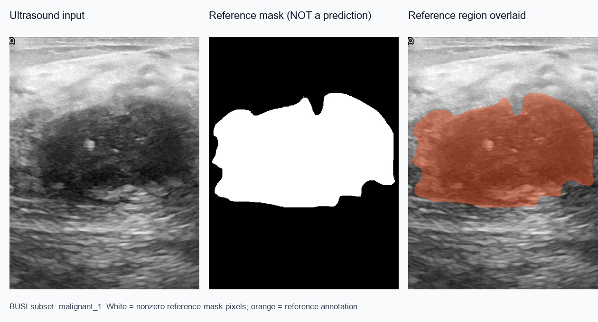
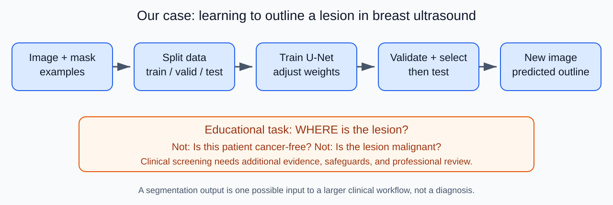
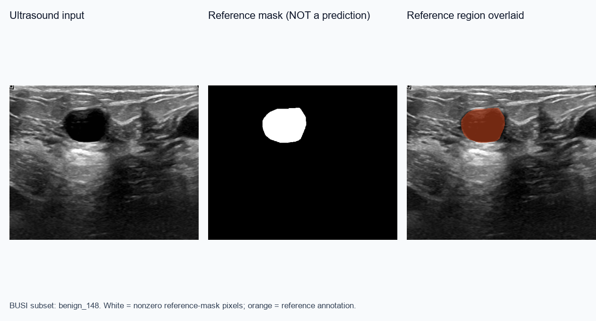
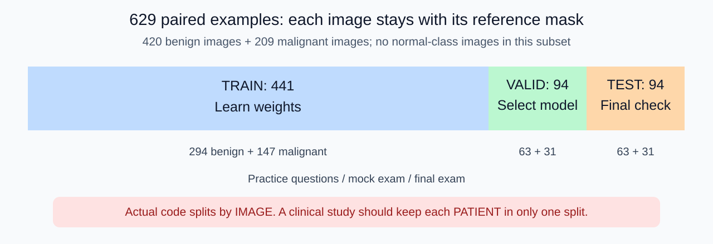
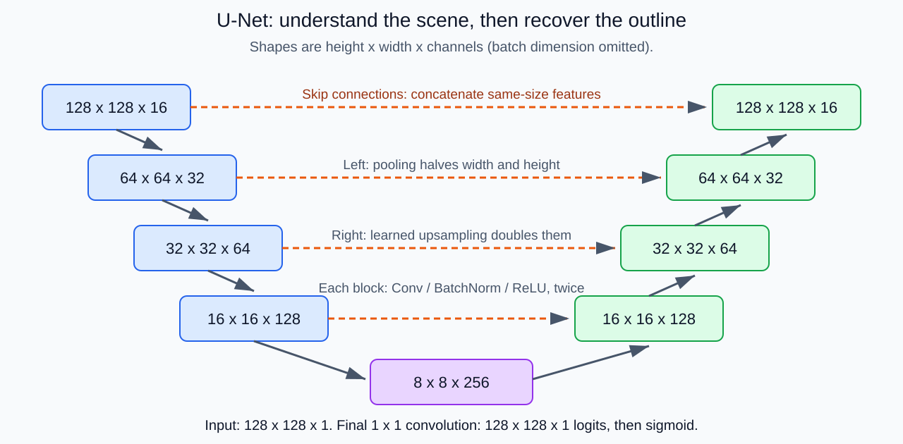
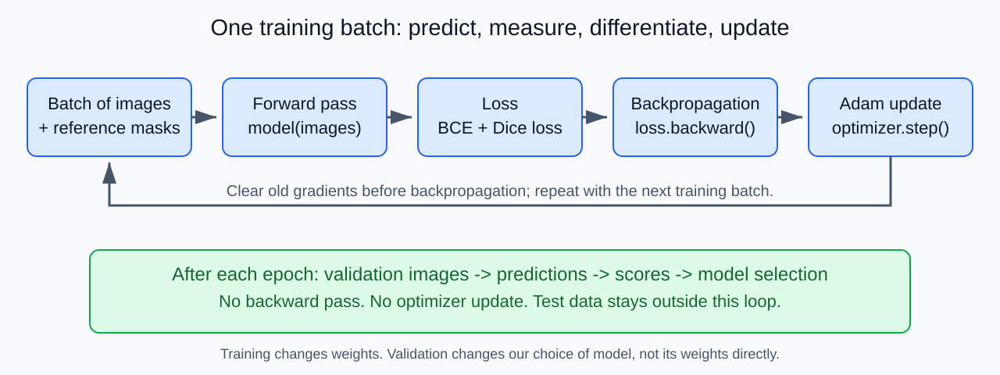
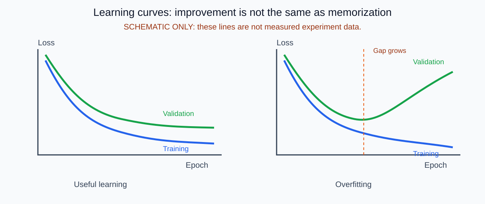
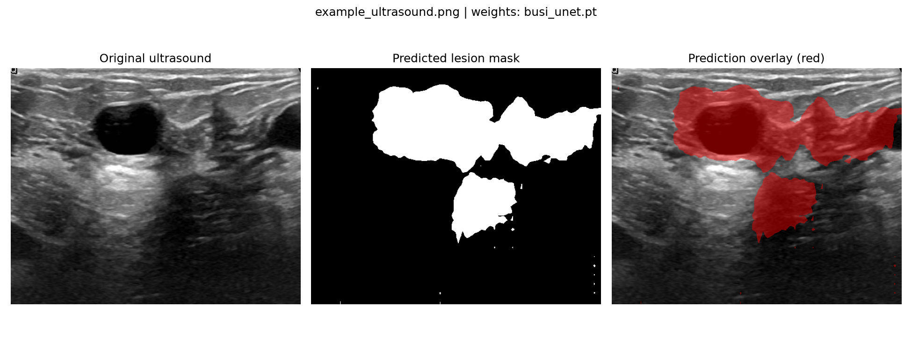
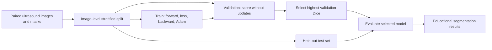

# From Ultrasound Images to Machine Learning
## A visual, slide-by-slide introduction for high school students

**Case study:** the breast-ultrasound lesion-segmentation project in `package1`.

**Audience:** students who have heard of machine learning but have little coding or hands-on experience.

**Suggested format:** two 45-minute lessons. Slides 01-18 explain data, networks, and training; slides 19-32 explain evaluation, experiments, and limitations. The appendices are optional.

**Learning goal:** explain how examples become a trained model, how we measure its mistakes, and why a high score is not automatically a trustworthy medical result.

> **Medical boundary:** this is an educational machine-learning case, not a diagnostic tool or medical advice. We use cancer early screening as the motivating scenario, but the existing program only segments lesions. It does not determine whether someone has cancer, identify early-stage cancer, or establish clinical screening performance.

### How to turn this document into a visual presentation

Each `Slide` section is one slide's content outline. Put the **main idea**, diagram, and short calculation on screen; use the **Speaker note** as narration rather than putting all its text on the slide. The document is a presentation storyboard and readable handout, **not a generated `.pptx` file**.

The linked PNGs and SVGs are local, reusable illustration assets. SVGs can be inserted into current PowerPoint versions without Mermaid support. Keep this document together with `teaching_assets` and the referenced `outputs` folder; preview it in a Markdown viewer that supports images and tables. Standard relative URLs are used for image links; PowerShell commands use Windows paths.

**Evidence labels used throughout**

| Label | Meaning |
|---|---|
| **Actual project** | Verified from `train_breast_cancer.py`, local data, or existing output files |
| **Teaching example** | Invented small numbers to make a concept easy to calculate |
| **Clinical extension** | A question or safeguard beyond what the existing program implements |

---

## Slide 01 - Could a computer help us notice a lesion?

**Main idea:** machine learning can help analyze images, but we must first define exactly what we want it to do.



**Look at the three panels:** an ultrasound image, a supplied reference mask, and that same annotation overlaid in orange. **These are labels, not model predictions.**

**Class question:** "If you were teaching a computer to outline the lesion, what examples would you give it?"

**Speaker note:** Start with a practical question, not equations. The image is named `malignant_1` in the dataset, but students should not infer a diagnosis from visual appearance alone. The white region tells the learning algorithm where the supplied annotation says the lesion is.

*Image attribution:* local curated BUSI subset; source and license are listed in Appendix D. The mask was displayed as white for nonzero pixels; the orange overlay is an educational visualization.

---

## Slide 02 - Three questions that sound similar but are different

| Task | Question | Typical output |
|---|---|---|
| Classification | "What category is this image?" | A class or class score |
| Detection | "Where are the suspicious objects?" | Bounding boxes |
| Segmentation | "Which pixels belong to the lesion?" | A pixel-by-pixel mask |

**Actual project:** `package1` implements **binary segmentation: lesion versus background**.

**Clinical extension:** cancer screening asks whether further assessment is needed. That is not equivalent to predicting a lesion mask.

**Speaker note:** Both benign and malignant lesions can have masks. A benign lesion is noncancerous; a malignant lesion is cancerous. "Lesion" is therefore not a synonym for "cancer." The program does not use benign/malignant as its output classes, even though those words appear in filenames and checkpoint metadata.

---

## Slide 03 - The whole story in one picture



**Main idea:** examples -> learning -> validation -> final evaluation -> predictions on new inputs.

**Class question:** "At which step does the computer change its internal settings?"

**Answer:** during training, using training images and their masks.

**Speaker note:** A model is a function with adjustable settings, called parameters. Training adjusts those parameters. Evaluation checks the current function without teaching it from the evaluation answers.

---

## Slide 04 - What is one data example?

**Actual project:** one example is a pair of files with the same name.

```text
Input x:     BUSI\images\malignant_1.png
Target y:    BUSI\labels\malignant_1.png

Input:  grayscale ultrasound
Target: 0 = background, 1 = lesion
```

The dataset loader converts **any nonzero mask value to 1**. The stored image values need not literally be 0 and 255.

**Supervised learning** means learning from inputs accompanied by reference answers.

**Speaker note:** Compare this to solving practice problems with an answer key. Labels are not magic truth: they can contain uncertainty or annotation errors. The image filename is not fed to U-Net as an input feature.

---

## Slide 05 - A second example: lesions are not all cancer



**Actual project:** this image is named `benign_148`. It still has a lesion annotation.

**Main idea:** the model learns to outline lesions in **both** categories.

**Class question:** "If the model outlines this lesion perfectly, has it proved that it can diagnose cancer?"

**Answer:** no. It has answered "where," not "benign or malignant."

**Speaker note:** Use this contrast to prevent a common misunderstanding before showing any evaluation scores.

*Image attribution:* local curated BUSI subset, CC BY 4.0 as recorded in the local dataset information; visualization changes are described in Appendix D.

---

## Slide 06 - Train, valid, and test: three different jobs



| Set | School analogy | What it is used for | Updates weights? |
|---|---|---|---|
| Train | Practice with feedback | Learn model parameters | Yes |
| Valid / validation / val | Mock exam | Choose model/settings | No |
| Test | Final exam | Evaluate the chosen approach | No |

**Actual project:** defaults are approximately 70% / 15% / 15%, producing **441 / 94 / 94 images**.

**Speaker note:** The code calls the validation set `val`. Counts are rounded separately within the benign and malignant groups. "No weight updates" does not mean validation has no influence: it influences our choices, so it is not a substitute for an untouched test set.

---

## Slide 07 - Why not practice on the final exam?

**Data leakage** happens when information from evaluation data influences learning or decisions inappropriately.

```text
Bad idea:
Look at test score -> change settings -> look again -> keep the best
The "final exam" has become another practice exercise.

Another risk:
Patient A, image 1 -> train
Patient A, image 2 -> test
The model may recognize patient-specific details.
```

**Actual project:** images are shuffled within benign/malignant groups and split **by image**, not by patient.

**Clinical extension:** keep all images from one patient in the same split; investigate duplicates and near-duplicates. Split before augmentation.

**Speaker note:** We cannot claim the current split is patient-independent, or assert that leakage definitely occurred without patient identifiers. We can identify the risk. A random seed makes the experiment easier to repeat; it does not remove leakage.

---

## Slide 08 - An image is a table of numbers

**Teaching example:** a tiny grayscale image:

```text
Stored brightness:                 After dividing by 255:

  0    64   255                     0.000  0.251  1.000
128   192    32                     0.502  0.753  0.125
255     0    96                     1.000  0.000  0.376
```

**Actual project:** convert to grayscale, scale brightness to 0-1, resize without changing aspect ratio, and add black padding.

For a `128 x 128` setting:

```text
One image tensor: [1, 128, 128]
Four-image batch: [4, 1, 128, 128]
                  batch, channel, height, width
```

**Speaker note:** Resizing is not the same as learning. Smaller images make experiments faster but can hide small boundaries and fine details. Black padding is included in this program's pixel accuracy, which can inflate the number of easy background pixels.

---

## Slide 09 - Data augmentation: new views, not new patients

```text
Original image   -> horizontal flip -> flipped image
Original mask    -> SAME flip       -> flipped mask
```

**Actual project:** a training pair has a 50% chance of being mirrored left-to-right. Validation and test pairs are not randomly augmented.

| Correct | Incorrect |
|---|---|
| Transform image and mask together | Flip the image but leave its answer unchanged |
| Augment training data only | Put near-identical copies across splits |
| Preserve meaningful image-label alignment | Treat augmentation as new independent patients |

**Speaker note:** Augmentation can encourage robustness to selected variations. It cannot invent all the diversity of new hospitals, scanners, or populations. The code uses smooth interpolation for images and nearest-neighbor interpolation for masks.

---

## Slide 10 - A neuron is an adjustable calculation

**Teaching example:** use two simplified, made-up image features.

```text
Darkness feature x1 = 0.8
Texture feature  x2 = 0.3

Weights: w1 = 2, w2 = -1; bias b = -0.5
Score z = w1*x1 + w2*x2 + b
        = 2*0.8 - 1*0.3 - 0.5
        = 0.8

Sigmoid: p = 1 / (1 + exp(-z)) = about 0.690
```

```text
x1 -- multiply by w1 --\
                        add bias -> score -> activation -> output
x2 -- multiply by w2 --/
```

**Main idea:** training changes weights and biases, not the reference answers.

**Speaker note:** This toy neuron is not a description of handcrafted features used by the actual model. U-Net learns many features from pixels. A sigmoid output is a model score between 0 and 1; it is not automatically a clinically calibrated probability.

---

## Slide 11 - Why a network instead of one neuron?

```text
Pixels -> local patterns -> larger patterns -> context -> pixel predictions
            edges            textures       shapes
```

**Main idea:** many layers can combine simple patterns into more complex functions.

**Actual project:** convolutional layers, BatchNorm, and ReLU form the main feature-processing blocks.

**ReLU teaching example:** `ReLU(z) = max(0, z)`.

```text
ReLU(-2) = 0
ReLU( 3) = 3
```

**Speaker note:** Without nonlinear activations, stacking ordinary linear calculations would still yield a linear calculation. "Edges -> textures -> shapes" is an intuition, not a promise that each learned channel has a neat, human-readable meaning. BatchNorm helps manage activation scales and behaves differently in training and evaluation.

---

## Slide 12 - Convolution: a small window scans the image

**Teaching example:** a `3 x 3` kernel applied to one image patch.

```text
Patch:                 Kernel:
0  0  0               -1 -1 -1
0  1  1                0  0  0
1  1  1                1  1  1

Multiply matching entries, then add:
0 + 0 + 0 + 0 + 0 + 0 + 1 + 1 + 1 = 3
```

Slide the same kernel to another location and repeat. The outputs form a **feature map**.

**Actual project:** each convolution block has two learned `3 x 3` convolutions with padding that preserves spatial dimensions.

**Speaker note:** The illustrated kernel is hand-chosen to respond to a brightness change, not an actual saved filter. Shared weights let the same local pattern be detected at many locations. Multiple kernels produce multiple feature channels.

---

## Slide 13 - U-Net: zoom out to understand, zoom in to outline



**Encoder:** extract features while reducing spatial size.

**Decoder:** enlarge feature maps to recover a pixel-level output.

**Skip connections:** bring same-size encoder features across to the decoder.

**Actual project:** 16 -> 32 -> 64 -> 128 -> 256 channels on the way down; the decoder reverses the progression.

**Speaker note:** Max pooling chooses the maximum in each small window and halves width and height. Learned transposed convolutions upsample on the way back. Skip connections concatenate features; they do not copy the target mask or guarantee precise boundaries.

---

## Slide 14 - From scores to a colored mask

**Actual project:** the final convolution gives one **logit**, or raw score, per pixel. Sigmoid converts each score to a 0-1 output.

**Teaching example:**

```text
Model output scores after sigmoid:    Threshold at 0.5:

0.10  0.60  0.80                       0  1  1
0.20  0.70  0.40                       0  1  0
0.05  0.30  0.90                       0  0  1
```

The actual rule is `p >= 0.5` -> lesion.

**Main idea:** prediction scores and final binary decisions are different objects.

**Speaker note:** A pixel score of 0.8 does not mean "this patient has an 80% chance of cancer." The model predicts a lesion label for a pixel. Clinical interpretation would require an entirely different evaluation.

---

## Slide 15 - Loss: a numerical penalty for bad predictions

**Loss function:** a calculation that tells training how far predictions are from reference answers.

**Actual project:**

```text
Total loss = Binary cross-entropy (BCE) + Dice loss
```

| Component | Intuitive job |
|---|---|
| BCE | Reward appropriate pixel scores; penalize confident wrong scores |
| Dice loss | Encourage overlap with the reference lesion region |

**Lower loss is generally better, but it is not an accuracy percentage.**

**Speaker note:** The program uses `BCEWithLogitsLoss`, which computes BCE directly from logits in a numerically stable way. It does not manually apply sigmoid before that call. Dice loss does use sigmoid probabilities. Loss is what the optimizer differentiates; reported metrics answer other questions.

---

## Slide 16 - Hand calculation: one-pixel BCE

**Teaching example:** the reference pixel is lesion, so `y = 1`.

```text
BCE(y, p) = -[y*ln(p) + (1-y)*ln(1-p)]

If y = 1: BCE = -ln(p)

Prediction p = 0.9 -> loss about 0.105
Prediction p = 0.6 -> loss about 0.511
Prediction p = 0.1 -> loss about 2.303
```

All else equal, a confident wrong prediction receives a larger penalty.

**Class question:** "At a threshold of 0.5, do 0.6 and 0.9 give the same accuracy for this pixel?"

**Answer:** yes: both are counted as correct. Their losses differ.

**Speaker note:** For a background pixel (`y = 0`), the penalty is `-ln(1-p)`. Students do not need to master logarithms here: focus on why confidence matters. Logs here are natural logarithms.

---

## Slide 17 - Gradient descent: how does the model improve?

**Main idea:** find which direction increases loss, then move a little in the opposite direction.

**Teaching example:** one parameter `w` and a simple loss:

```text
L(w) = (w - 3)^2
Gradient dL/dw = 2*(w - 3)
Update: w_new = w_old - learning_rate * gradient

Start: w = 0; learning rate = 0.1
Gradient = 2*(0 - 3) = -6
New w = 0 - 0.1*(-6) = 0.6

Old loss = (0 - 3)^2   = 9
New loss = (0.6 - 3)^2 = 5.76
```

**Class activity:** calculate the next step. Answer: gradient `-4.8`, new weight `1.08`, new loss `3.6864`.

**Speaker note:** This is a toy squared-error calculation, not the ultrasound model's loss landscape. Real networks have many parameters and do not guarantee a lower loss after every batch update.

---

## Slide 18 - Backpropagation, learning rate, and Adam

| Term | Plain-language explanation |
|---|---|
| Gradient | How loss changes when a parameter changes |
| Backpropagation | Apply the chain rule through the network to calculate gradients |
| Learning rate | A setting controlling update size |
| Optimizer | The rule that turns gradients into parameter updates |

**Actual project:** the optimizer is **Adam**, with default learning rate `0.0001` (`1e-4`).

**Adam is not exactly the simple gradient-descent formula:** it uses running estimates of gradients and squared gradients to adapt updates.

**Speaker note:** A small learning rate may learn slowly; an overly large one can overshoot or destabilize training. There is no universal best setting. Backpropagation calculates gradients; the optimizer performs the update. Do not describe them as the same operation.

---

## Slide 19 - One batch, one epoch, many updates



**Batch:** a group of examples processed together.

**Epoch:** one pass through the training set.

**Actual project example:** 441 training images with batch size 4:

```text
110 full batches of 4 + 1 final batch of 1 = 111 batches per epoch
10 epochs -> 1,110 optimizer updates
```

**Code connection:**

```python
logits = model(images)
loss = loss_function(logits, masks) + dice_loss(logits, masks)
optimizer.zero_grad()
loss.backward()
optimizer.step()
```

**Speaker note:** The batch illustration uses size 4; the command-line default is 2. Validation runs after each epoch without gradient calculation or optimizer steps. More epochs do not create more independent patients.

---

## Slide 20 - Overfitting: learning the examples too well



**Teaching illustration, not measured results.**

**Useful learning:** training and validation performance improve together.

**Overfitting:** training continues improving while validation gets worse; the model may be learning quirks that do not generalize.

**Actual project:** retain the weights with the **highest validation Dice**, reload them, and evaluate on the test set.

**Speaker note:** The project does not implement automatic early stopping: it finishes the requested epochs and selects the best observed validation model. It saves weights to disk only after the training loop finishes. Augmentation, suitable model capacity, and more representative data can help; none guarantees generalization.

---

## Slide 21 - Accuracy: correct out of all decisions

**Definition:**

```text
Accuracy = number of correct decisions / total decisions
```

**Teaching example:** an image contains 10,000 pixels. Only 500 are lesion.

```text
Model predicts BACKGROUND for every pixel.

Correct background pixels = 9,500
Missed lesion pixels      =   500
Pixel accuracy            = 9,500 / 10,000 = 95%
Lesion recall             = 0 / 500 = 0%
```

**Main idea:** 95% accuracy can coexist with missing the entire lesion.

**Speaker note:** Here Precision is undefined because the model predicts no positives; do not report it as evidence of good performance. The actual code includes background and padding in pixel accuracy. Its score is not the percentage of patients correctly diagnosed.

---

## Slide 22 - Four kinds of outcomes: the confusion matrix

**For the next three slides, one decision means ONE PIXEL. Positive means lesion.**

**Teaching example:** 100 evaluated pixels.

| | Reference: lesion | Reference: background |
|---|---:|---:|
| Predicted lesion | **TP = 16**: correctly included | **FP = 8**: incorrectly included |
| Predicted background | **FN = 4**: missed lesion | **TN = 72**: correctly excluded |

```text
Reference lesion pixels = TP + FN = 20
Predicted lesion pixels = TP + FP = 24
All pixels              = 16 + 8 + 4 + 72 = 100
```

**Main idea:** false positives overpaint; false negatives leave holes or miss regions.

**Speaker note:** These are made-up numbers, not output from `package1`. The same matrix structure can describe patients, images, lesions, or pixels, but its meaning changes with the evaluation unit.

---

## Slide 23 - Precision and Recall ask different questions

The metric is spelled **Precision**, not "Precession."

| Metric | Question | Calculation from Slide 22 |
|---|---|---|
| Precision | Of the pixels I painted, how many really were lesion? | `TP/(TP+FP) = 16/24 = 66.7%` |
| Recall / sensitivity | Of all reference lesion pixels, how many did I find? | `TP/(TP+FN) = 16/20 = 80%` |
| Specificity | Of all background pixels, how many did I leave out? | `TN/(TN+FP) = 72/80 = 90%` |
| Accuracy | Of all pixels, how many did I label correctly? | `(TP+TN)/100 = 88%` |

**Memory aid:** Precision checks the **predicted positives**; Recall checks the **reference positives**.

**Speaker note:** Precision and Recall are not printed by the current training script; we introduce them conceptually. If a denominator is zero, report the metric as undefined or disclose the chosen convention. Never quietly interpret an undefined value as a perfect score.

---

## Slide 24 - Dice, F1, and IoU: how much do regions overlap?

**Teaching example:** use the same pixel counts.

```text
Reference region A: 20 pixels
Predicted region B: 24 pixels
Overlap A intersect B: 16 pixels

Dice = 2*overlap / (size(A) + size(B))
     = 2*16 / (20 + 24)
     = 32/44 = 0.7273

IoU = overlap / union
    = 16 / (20 + 24 - 16)
    = 16/28 = 0.5714

F1 = 2*Precision*Recall / (Precision + Recall)
   = 2*TP / (2*TP + FP + FN)
   = 32/44 = 0.7273
```

For a binary mask and the **same pooled pixel counts**, Dice equals positive-class F1. Different averaging rules can give different dataset summaries.

**Speaker note:** Dice and IoU exclude true negatives from these formulas, so large background regions cannot directly dominate them. Dice near 1 means high overlap, not perfect patient-level cancer diagnosis.

---

## Slide 25 - Training Dice loss is not the reported Dice score

**Actual project:**

| During training | During evaluation |
|---|---|
| Use continuous sigmoid outputs | Convert outputs to 0/1 using threshold 0.5 |
| Compute a soft Dice for each image | Pool intersection and region sizes across the set |
| Add 1 to numerator and denominator for smoothing | No smoothing for a nonempty denominator |
| Loss is `1 - mean(soft Dice)` | Report the pooled hard Dice |

**Teaching example:** four pixels:

```text
Reference y:    [1,   1,   0,   0]
Prediction p:  [0.8, 0.6, 0.3, 0.1]

Soft intersection = 0.8 + 0.6 = 1.4
Sum p = 1.8; sum y = 2
Smoothed soft Dice = (2*1.4 + 1) / (1.8 + 2 + 1)
                   = 3.8/4.8 = 0.7917
Dice loss          = 1 - 0.7917 = 0.2083

Thresholded prediction = [1, 1, 0, 0]
Hard Dice for these four pixels = 1.0
```

**Speaker note:** The soft version provides gradients. Training on a hard threshold would obstruct useful gradients through that threshold. The full training loss also includes BCE, so it is not merely `1 - val_dice`. For an evaluation set with no reference or predicted positive pixels, this implementation returns Dice 1 by convention.

---

## Slide 26 - Thresholds trade one kind of mistake for another

**Teaching example:** six pixel scores.

```text
Pixel:       A     B     C     D     E     F
Reference:   1     1     1     0     0     0
Score:      0.90  0.70  0.40  0.60  0.30  0.10
```

| Threshold (`score >= threshold`) | TP | FP | FN | Precision | Recall |
|---|---:|---:|---:|---:|---:|
| 0.8 | 1 | 0 | 2 | 100% | 33.3% |
| 0.5 | 2 | 1 | 1 | 66.7% | 66.7% |
| 0.3 | 3 | 2 | 0 | 60% | 100% |

**Main idea:** a lower threshold includes more pixels; Recall cannot decrease for fixed scores and reference labels. Precision can move either way, depending on the added pixels.

**Actual project:** threshold is fixed at 0.5; there is no implemented threshold sweep.

**Speaker note:** Clinical screening often places a high cost on missed cases, but false alarms also create follow-up burden. Select any operating threshold using development/validation data and a defined objective, not by trying to maximize the final test score.

---

## Slide 27 - ROC, PR curves, and the unit of evaluation

**Clinical extension:** for a classifier with a score for each patient or image, vary the decision threshold.

| Curve / metric | What it summarizes |
|---|---|
| ROC curve | True-positive rate (Recall) versus false-positive rate |
| False-positive rate | `FP/(FP+TN) = 1 - Specificity` |
| ROC-AUC | Ranking performance across thresholds |
| Precision-Recall curve | Precision versus Recall across thresholds |
| PR-AUC / average precision | Related PR summaries; definitions and interpolation differ |

PR analysis can be especially informative when positive cases are rare. Its values depend on positive prevalence.

**Important:** these curves can also be computed for pixel scores, but **pixel-level AUC is not patient-level screening AUC**.

**Speaker note:** A high ROC-AUC does not tell us how many false alarms occur at a particular operating threshold. The existing program implements none of these curves. An AUC of 0.9 does not mean "90% of patients correctly diagnosed."

---

## Slide 28 - A screening thought experiment: rare conditions matter

**Clinical teaching example, not BUSI results:** imagine a hypothetical screening classifier applied to 1,000 people.

```text
10 actually have the condition; 990 do not.
Sensitivity = 90%: TP = 9, FN = 1
Specificity = 90%: TN = 891, FP = 99

Precision = 9 / (9 + 99) = 8.3%
Accuracy  = (9 + 891) / 1,000 = 90%
```

**Main idea:** many false alarms can arise in a low-prevalence population, even with seemingly good sensitivity and specificity.

**Class question:** "Does a positive result necessarily mean the person has cancer?"

**Answer:** no. A screening result may indicate a need for further assessment; it is not a diagnosis.

**Speaker note:** This is why evaluation must match the intended population. `package1` contains lesion images but no normal-class images, and is not a representative general-population screening cohort. It cannot establish these patient-level numbers.

---

## Slide 29 - Read the project's actual results carefully

**Actual project:** the existing `outputs\first_try\busi_training_metrics.csv` has **one epoch row**.

| Epoch | Train loss | Train pixel accuracy | Validation loss | Validation pixel accuracy | Validation Dice |
|---:|---:|---:|---:|---:|---:|
| 1 | 1.455381 | 0.782901 | 1.328989 | 0.911216 | 0.526865 |

**Reasonable conclusion:** validation pixel accuracy was about 91.1%, while the reported overlap Dice was about 0.527 in this recorded run.

**Unreasonable conclusions:** "91.1% of patients were diagnosed correctly," "early cancer is detected reliably," or "the model is overfitting."

**Speaker note:** One row cannot reveal a trend or an overfitting curve. Validation can look better than the training aggregate because training uses augmentation and changing weights, while validation uses fixed end-of-epoch weights and evaluation-mode BatchNorm. This is a possible explanation, not proof of the cause here. This CSV contains no test metrics; do not invent them or assume another saved image came from this same model.

---

## Slide 30 - Inspect an actual prediction, not just a score



**Actual project artifact:** the existing visualization saved in `outputs\BUSI`. The red region is a **prediction**, unlike the reference overlays on Slides 01 and 05.

Compare it with the `benign_148` reference visualization on Slide 05. Some predicted regions appear beyond the supplied reference lesion area.

**Main idea:** visually plausible output can still include substantial mistakes.

**Speaker note:** The repository guide identifies `example_ultrasound.png` as a copy of `benign_148.png`. The figure names its weight file but does not establish all training settings, the split membership, or a quantitative score. Do not associate this image with the `first_try` CSV without evidence. This is not an independent clinical test. The prediction command alone does not compare the output with a reference mask.

---

## Slide 31 - A small experiment students can actually understand

**Predict -> change one thing -> observe -> explain.**

| Experiment | Keep fixed | Change | What to compare |
|---|---|---|---|
| A versus B | Seed, size, batch, split, epochs | Learning rate | Validation loss/Dice curves |
| B versus C | Seed, rate, batch, split, epochs | Input size | Detail, runtime, validation Dice |

**Before running:** write a hypothesis, such as "a larger image may preserve boundary details but take longer."

**After running:** compare validation results and visual errors. Select an approach before interpreting its test result.

**Speaker note:** You can do the calculations on Slides 17, 22-26 without writing code. If doing an actual experiment, use the commands in Appendix A, start small, and avoid launching many large jobs at once. Do not use the automatically printed test scores to choose the next settings; that would contaminate the test set's role.

---

## Slide 32 - What have we learned, and what remains unproved?

```text
Data + reference labels
    -> network produces scores
    -> loss measures errors
    -> gradients guide updates
    -> validation selects a model
    -> test checks held-out performance
    -> metrics + visual inspection reveal different mistakes
```

**Actual project measures:** pixel accuracy and lesion overlap on an image-level split.

**Not established:** patient-level diagnosis, early-stage detection, safe deployment, or reliable performance at a new hospital.

**Exit question:** "Explain why a 95%-accurate pixel model might still miss every lesion."

**Speaker note:** Clinical work would also require appropriate patient-level evaluation, representative normal and diseased cases, external validation, uncertainty estimates, privacy safeguards, relevant expert review, and regulatory/ethical assessment. The key lesson is not "AI is good" or "AI is bad": it is **define the question, preserve honest evaluation, and interpret the evidence at the right level**.

---

# Appendix A - Optional hands-on demonstration

## A1. Prepare an environment

Run from the repository root in Windows PowerShell:

```powershell
Set-Location .\package1
python -m venv .venv
.\.venv\Scripts\python.exe -m pip install -r .\requirements.txt
```

If a suitable environment already exists, use its Python executable instead. The dataset is already local; no new download is needed.

## A2. Run a small smoke experiment

```powershell
.\.venv\Scripts\python.exe -u .\train_breast_cancer.py --epochs 1 --image-size 64 --batch-size 4 --output-dir .\outputs\lesson_smoke
```

This is a plumbing check, **not an attempt to establish medical performance**. It still uses the full split; the small image size and epoch count reduce computation.

Expected output types:

```text
Images: 629 | train: 441 | validation: 94 | test: 94
Training device: cpu OR cuda
Epoch ... train loss ... val loss ... val Dice ...
Test pixel accuracy: <measured value>
Test Dice: <measured value>
```

Do not expect particular metric values. Device differences and random numerical behavior can affect results.

## A3. Compare learning rates using validation results

```powershell
.\.venv\Scripts\python.exe -u .\train_breast_cancer.py --epochs 5 --image-size 64 --batch-size 4 --lr 0.0001 --seed 42 --output-dir .\outputs\lesson_lr_a
.\.venv\Scripts\python.exe -u .\train_breast_cancer.py --epochs 5 --image-size 64 --batch-size 4 --lr 0.0002 --seed 42 --output-dir .\outputs\lesson_lr_b
```

These are small educational comparisons, not recommended clinical settings. Keep seed and split fractions unchanged. Open each CSV in Excel and chart epoch versus train/validation loss, then validation Dice separately.

**Test-set warning:** the current script automatically evaluates test data after each run. For this classroom comparison, do not use those test scores to choose settings. A more rigorous experiment runner would defer test evaluation until the approach is fixed; this document does not alter the training script.

## A4. Show a prediction without retraining

```powershell
.\.venv\Scripts\python.exe .\train_breast_cancer.py --predict .\example_ultrasound.png --weights .\outputs\lesson_smoke\busi_unet.pt --output-dir .\outputs\lesson_demo --no-show
```

The files will be:

```text
outputs\lesson_demo\example_ultrasound_prediction.png
outputs\lesson_demo\example_ultrasound_mask.png
```

Remove `--no-show` to display the figure in a window. Input size and threshold come from the checkpoint, not the training `--image-size` option.

**Ask students:** Which parts look overpainted? Which might be missed? What reference data would you need to measure that?

## A5. Practical limitations

- CPU training can take time; start with one epoch and small images.
- Image size must be at least 32 and a multiple of 16; default is 256.
- Default batch size is 2, epoch count is 20, and learning rate is `1e-4`.
- Use a different output directory for each run; existing filenames can be overwritten.
- The CSV updates each epoch, but weights are saved only after all epochs finish.
- Training restarts from scratch; the CSV is not a resumable checkpoint.

---

# Appendix B - Paper-and-pencil mini-lab

## B1. Paint a tiny lesion

**Teaching example:** `1` means lesion; `0` means background.

```text
Reference mask:        Predicted mask:

0 0 0 0               0 0 0 0
0 1 1 0               0 1 1 1
0 1 1 0               0 1 0 0
0 0 0 0               0 0 0 0
```

Tasks: count TP, FP, FN, TN; calculate Accuracy, Precision, Recall, Dice, and IoU.

**Answer key:**

```text
TP = 3, FP = 1, FN = 1, TN = 11
Accuracy  = 14/16 = 87.5%
Precision = 3/4   = 75%
Recall    = 3/4   = 75%
Dice      = 6/8   = 0.75
IoU       = 3/5   = 0.60
```

**Discussion:** one false positive and one false negative can produce the same score while appearing in very different locations. Overlap alone does not describe every boundary error.

## B2. Choose an evaluation level

For each claim, name the extra evidence needed.

| Claim | What would need to be measured? |
|---|---|
| "The lesion outline matches well." | Reference masks and segmentation metrics |
| "The image is classified malignant." | Image-level reference classes and classification evaluation |
| "The system detects cancer in patients." | Patient-level reference outcomes and an appropriate cohort |
| "The system finds early-stage cancer." | Reliable stage information and early-stage subgroup evaluation |
| "The system works in another hospital." | External data and independent evaluation there |

## B3. Five quick comprehension checks

1. Which set updates model weights? **Train.**
2. Does Recall check predicted positives or reference positives? **Reference positives.**
3. Why use a soft loss rather than a hard mask during training? **Useful gradients.**
4. Is Dice 0.8 the same as 80% patient diagnostic accuracy? **No.**
5. Does a normal-free lesion dataset prove screening reliability? **No.**

---

# Appendix C - Match the concepts to the actual code

| Concept | Function / class / expression |
|---|---|
| Pair images with masks | `find_samples` |
| Stratified image-level split | `stratified_split` |
| Read, normalize, augment | `BUSIDataset.__getitem__` |
| Keep aspect ratio and pad | `resize_with_padding` |
| Feature extraction | `ConvBlock` |
| Encoder, decoder, skip connections | `UNet` |
| Differentiable overlap penalty | `dice_loss` |
| BCE, backward pass, optimizer step | `run_epoch` |
| Adam and learning rate | `train`: `torch.optim.Adam(...)` |
| Best-model selection | `train`: compare `val_dice` with `best_val_dice` |
| Pooled evaluation Dice | `calculate_dice` |
| Pixel accuracy including padding | `calculate_pixel_accuracy` |
| Prediction and red overlay | `predict_image` |
| Parameter values and checks | `main` |

### What the program does and does not report

| Quantity | Implemented? | Notes |
|---|---|---|
| Train / validation loss | Yes | BCE + soft Dice loss |
| Train / validation pixel accuracy | Yes | Training aggregate uses predictions made during updates |
| Validation / test Dice | Yes | Pooled, thresholded pixel overlap |
| Test pixel accuracy | Yes | Printed and stored in checkpoint |
| Precision / Recall / Specificity / IoU | No | Taught here with hypothetical calculations |
| ROC / PR curves | No | Conceptual extension |
| Patient-level cancer classifier | No | Lesion/background segmentation only |
| Clinical deployment validation | No | Outside this educational package |

### Optional editable flowchart source

The supplied SVG diagrams require no Mermaid rendering. This Mermaid source is an extra editable representation for compatible Markdown viewers:



---

# Appendix D - Sources, illustration provenance, and sharing

## Project evidence

- `train_breast_cancer.py`: task definition, model, preprocessing, split, loss, evaluation, defaults, and prediction behavior.
- `readme.txt`: usage guide, educational scope, data limitations, and identification of the example image.
- `data\BUSI\BUSI\DATASET_INFO.txt`: recorded source, attribution, and subset information.
- `outputs\first_try\busi_training_metrics.csv`: the single real metrics row reproduced on Slide 29.
- `outputs\BUSI\example_ultrasound_prediction.png`: the existing prediction artifact shown on Slide 30; complete training provenance is not established by that image.

**Local dataset counts:** 629 ultrasound images, comprising 420 benign and 209 malignant, with 629 corresponding masks. This curated subset contains no normal-class images.

## Dataset attribution

Original dataset paper:

> Al-Dhabyani W, Gomaa M, Khaled H, Fahmy A. *Dataset of breast ultrasound images*. Data in Brief. 2020;28:104863. DOI: [10.1016/j.dib.2019.104863](https://doi.org/10.1016/j.dib.2019.104863).

Curated subset source recorded in this package:

- [Zenodo record 21128640](https://zenodo.org/records/21128640)
- DOI: [10.5281/zenodo.21128640](https://doi.org/10.5281/zenodo.21128640)
- License recorded in the local dataset information: **CC BY 4.0**

The record and license are cited from the repository's local metadata, not independently reverified here. Preserve source attribution and check applicable license terms before redistribution.

## Illustration changes

The figures `malignant_1_reference.png` and `benign_148_reference.png` are derived from the matching local BUSI image-mask pairs. Changes: fit images into a presentation panel, display nonzero reference-mask pixels as white, overlay the reference region in orange, and add explanatory headings. They do **not** contain model predictions.

The five SVG diagrams are original educational schematics. `learning_curves.svg` is explicitly hypothetical; it is not a plot of the one-row experiment CSV. All hand-calculated confusion matrices, thresholds, neuron values, and screening numbers are hypothetical unless labeled otherwise.

To regenerate the two reference illustrations on Windows with the project dependencies installed:

```powershell
Set-Location .\package1
.\.venv\Scripts\python.exe .\make_teaching_images.py
```

The illustration generator uses the Windows Arial font. Keep the generated PNGs when sharing the slide assets; viewers do not need to run the generator.

**Final takeaway:** machine learning learns from examples, optimization adjusts a model, and evaluation tests a specific claim. Always check whether the claim matches the task, data, and unit of measurement.
