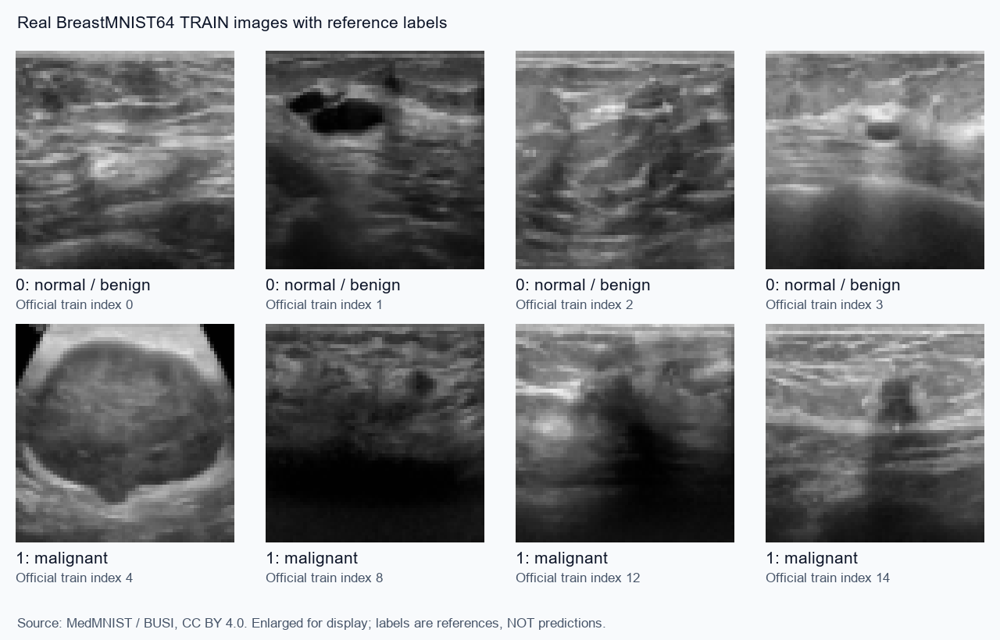
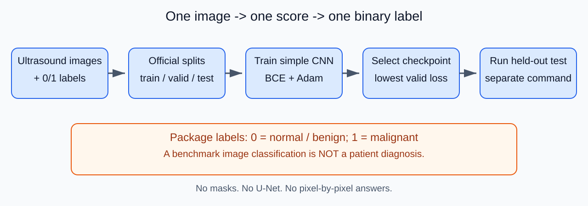
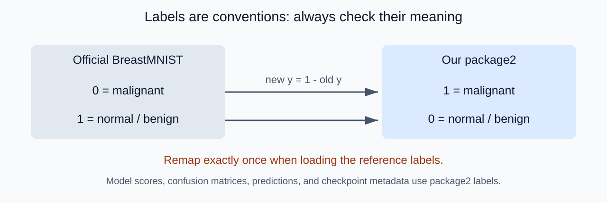
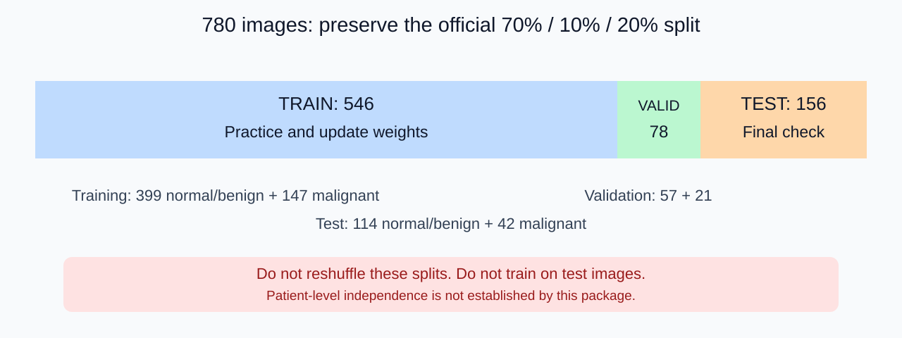
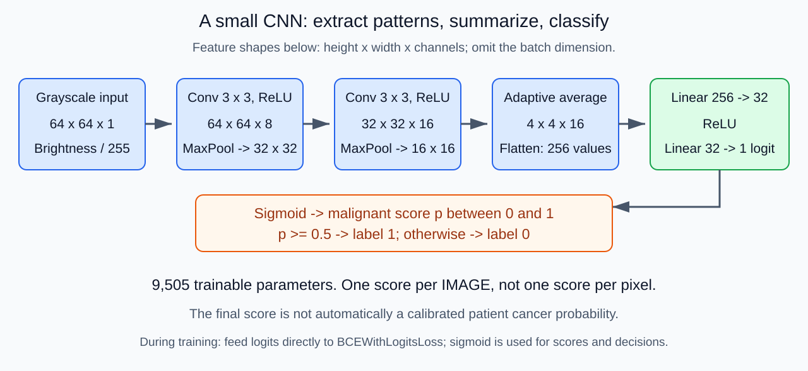
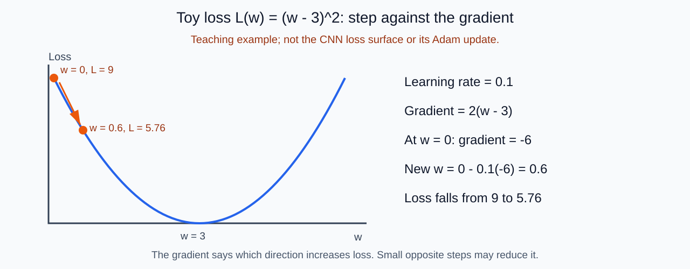
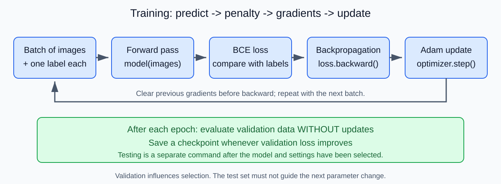

# One Ultrasound Image, One Label
## A visual introduction to machine learning with BreastMNIST64

**Audience:** high school students encountering machine learning for the first time.

**Case:** train a small neural network to classify a breast-ultrasound image as **normal/benign (0)** or **malignant (1)** according to the dataset's reference label.

**Format:** 32 slide outlines with speaker notes, local illustrations, worked calculations, and optional hands-on exercises. Suggested delivery: two 45-minute lessons. Slides 01-18 introduce data and learning; slides 19-32 introduce evaluation and experiments.

> **Educational use only.** This package is not a diagnostic tool. Its score describes a low-resolution benchmark image; it does not diagnose a person, establish an early cancer stage, or demonstrate safe clinical screening.

## Using this document as a PPT storyboard

Each `Slide` section supplies a main idea, screen content, and narration. Show the picture and a few key lines; keep the **Speaker note** in your presenter notes. This is a Markdown lesson and PPT storyboard, not an exported `.pptx`.

Images use standard relative URLs. Keep the document, `teaching_assets`, and `outputs` together. The SVG diagrams can be inserted into current PowerPoint versions; they do not require Mermaid support. Commands below use Windows PowerShell paths.

| Evidence label | Meaning |
|---|---|
| **Actual package** | Implemented behavior or verified BreastMNIST64 data |
| **Teaching example** | Small hypothetical numbers for hand calculation |
| **Clinical extension** | A question that this educational package cannot answer |

**What becomes simpler than `package1`?**

| `package1`: segmentation | `package2`: classification |
|---|---|
| One reference label per pixel | One reference label per image |
| An image paired with a mask | An image paired with the number 0 or 1 |
| U-Net with encoder and decoder | Small CNN with two convolutional layers |
| Predict a lesion outline | Predict a malignant-class score |
| Pixel accuracy and Dice | Image accuracy, Precision, Recall, Specificity, F1 |

---

## Slide 01 - Can a computer learn from labeled ultrasound images?



**Main idea:** examples consist of an image and an answer.

Top row: **0 = normal or benign**. Bottom row: **1 = malignant**.

These are **reference labels**, not predictions. Images are enlarged from 64×64 for display.

**Class question:** "What information would a computer need before it could practice this task?"

**Speaker note:** It needs examples, labels, a model, and a way to measure mistakes. Do not ask students to diagnose the pictures. Normal and benign are combined in this benchmark; neither label is a certificate that an arbitrary patient is cancer-free.

*Attribution:* BreastMNIST64, MedMNIST / BUSI, CC BY 4.0. Source citations and illustration transformations are in Appendix D.

---

## Slide 02 - Define the question before building the model

```text
Input:  one 64 x 64 grayscale ultrasound image
Output: one score for the malignant class
Decision: score >= 0.5 -> label 1; otherwise -> label 0
```

**Actual package:** binary **image classification**. There are no segmentation masks.

**Clinical extension:** "Does this person have cancer?" requires patient-level evidence beyond this image benchmark.

**Speaker note:** Classification, detection, and segmentation are different tasks. This package predicts one class for the whole image. It does not show which pixels caused the decision or identify the lesion's location.

---

## Slide 03 - The whole learning story



**Main idea:** learning and checking are separate jobs.

```text
Train -> change the model's weights
Validate -> choose a checkpoint
Test -> evaluate the selected approach
Predict -> apply that approach to an input image
```

**Speaker note:** Parameters are adjustable numbers inside the model. Predictions do not require reference labels, but training and honest evaluation do.

---

## Slide 04 - What do 0 and 1 actually mean?



**Actual package:** the official BreastMNIST convention is reversed for this lesson:

```text
package_label = 1 - official_label
```

The remapping happens **once**, when loading reference labels. All package metrics and predictions use **1 = malignant**.

**Class question:** "Is the number 1 always the cancer class in every dataset?"

**Answer:** no. Labels are conventions that must be checked.

**Speaker note:** This detail matters for Recall and Precision: we explicitly define malignant as the positive class. Reversing labels twice would silently reverse the task. The checkpoint records the package label meaning.

---

## Slide 05 - Train, valid, and test: practice, mock exam, final exam



| Set | Size | Job | Changes weights? |
|---|---:|---|---|
| Train | 546 | Learn from labeled examples | Yes |
| Valid / val | 78 | Check learning and select a model | No |
| Test | 156 | Evaluate the selected approach | No |

**Actual package:** preserve the supplied official split; do not randomly resplit the 780 images.

**Speaker note:** This differs from `package1`, which split its own image list. Our random seed affects initialization and training order, not the official membership of these sets.

---

## Slide 06 - Why the final exam must stay separate

```text
Bad workflow:
Check test score -> change learning rate -> check test again -> choose the best

Better workflow:
Compare settings using validation -> choose -> test afterward
```

**Actual package:** training does **not** automatically evaluate the test set. Testing uses a separate `--test` command.

**Leakage warning:** do not mix augmented copies or different-resolution versions of the same image across splits.

**Speaker note:** Keeping the official split is necessary for comparable benchmark results, but does not establish patient-level independence. This package cannot prove that all images from each patient stay in only one split.

---

## Slide 07 - A picture is a matrix of numbers

**Teaching example:**

```text
Brightness before scaling:       After dividing by 255:

  0    64   255                  0.000  0.251  1.000
128   192    32                  0.502  0.753  0.125
255     0    96                  1.000  0.000  0.376
```

**Actual package:**

```text
Single input: [1, 64, 64]
Batch input:  [32, 1, 64, 64]
               batch, channel, height, width
```

**Speaker note:** Grayscale has one channel. Images are already 64×64 in the downloaded archive. Scaling brightness changes the representation, not the label. Enlarging an image for a slide does not create new medical detail.

---

## Slide 08 - Before a neural network: a simple baseline

**Actual data:** training has 399 normal/benign and 147 malignant images.

A classifier that always predicts **0** would have:

```text
Training accuracy = 399 / 546 = about 73.1%
Malignant Recall  = 0 / 147 = 0%
```

**Main idea:** a respectable-looking accuracy can come from predicting only the majority class.

**Speaker note:** This is a calculation from class counts, not a trained model. A baseline helps us interpret whether the model adds useful information. Accuracy alone can hide complete failure on malignant examples.

---

## Slide 09 - One neuron: an adjustable calculation

**Teaching example:** imagine two simplified image features.

```text
Darkness x1 = 0.8; texture x2 = 0.3
Weights w1 = 2; w2 = -1; bias b = -0.5

z = w1*x1 + w2*x2 + b
  = 2*0.8 - 1*0.3 - 0.5 = 0.8

sigmoid(z) = 1 / (1 + exp(-z)) = about 0.690
```

```text
x1 -- weight w1 --\
                   add bias -> activation -> output
x2 -- weight w2 --/
```

**Speaker note:** This toy neuron is not the actual network's handcrafted input. The CNN learns features from pixels. Training changes weights and biases, not the reference labels.

---

## Slide 10 - Many neurons form a neural network

```text
Pixels -> local patterns -> summarized features -> class score
```

**Main idea:** layers combine calculations; nonlinear activations allow more complex functions.

```text
ReLU(z) = max(0, z)
ReLU(-2) = 0
ReLU( 3) = 3
```

**Actual package:** uses ReLU between learned layers and sigmoid to interpret the final score.

**Speaker note:** A network is not a miniature doctor. It is a mathematical function trained to fit reference labels. "Patterns" need not correspond to human-readable features; it can also learn shortcuts or artifacts.

---

## Slide 11 - Convolution: scan with a small window

**Teaching example:**

```text
Image patch:           Kernel:
0 0 0                 -1 -1 -1
0 1 1                  0  0  0
1 1 1                  1  1  1

Multiply corresponding entries and add:
0 + 0 + 0 + 0 + 0 + 0 + 1 + 1 + 1 = 3
```

Moving the same window across the image creates a **feature map**.

**Actual package:** learns `3 x 3` convolution kernels. Its first layer produces eight feature channels.

**Speaker note:** The illustrated kernel is made up; trained kernels are learned. Shared weights let the same local pattern be processed at multiple locations.

---

## Slide 12 - Pooling: make a compact summary

**Teaching example:** a `2 x 2` max-pooling window:

```text
1  4
2  3   ->   4
```

**Actual package:**

```text
Max pooling: 64 x 64 -> 32 x 32 -> 16 x 16
Adaptive average pooling: each channel becomes 4 x 4
Flatten: 16 channels * 4 * 4 = 256 numbers
```

**Speaker note:** Pooling reduces spatial detail and computation. Max pooling and average pooling are different operations. Adaptive average pooling provides a fixed-size feature representation here. Unlike U-Net, this classifier does not reconstruct a pixel mask.

---

## Slide 13 - Our actual CNN is small enough to draw



**Actual package:** two convolutional layers, two pooling steps, a small hidden layer, and one output.

**Main idea:** the whole image becomes **one logit**, not thousands of pixel labels.

**Speaker note:** The model has 9,505 trainable parameters. Shapes in the picture use height × width × channels; PyTorch tensors use channel × height × width for a single image. Hyperparameters define the experiment; weights are the learned values.

---

## Slide 14 - A score is not a decision

**Teaching example:**

| Image | Malignant score | Decision at threshold 0.5 |
|---|---:|---|
| A | 0.10 | 0: normal/benign |
| B | 0.49 | 0: normal/benign |
| C | 0.50 | 1: malignant |
| D | 0.90 | 1: malignant |

**Actual package:** `score >= threshold` is the positive decision rule.

**Speaker note:** A score of 0.9 is not automatically a calibrated 90% chance that a person has cancer. Calibration, population differences, and clinical interpretation require additional work. Close-to-threshold scores can change labels after small numerical changes.

---

## Slide 15 - Forward pass: make a prediction

```text
Image -> normalize -> CNN -> logit z -> sigmoid -> score p -> decision
```

**Actual package:** a training batch produces 32 logits when the batch contains 32 images.

```python
logits = model(images)
```

**Main idea:** a forward pass calculates outputs using the current weights. It does not by itself update them.

**Speaker note:** Forward passes are used in training, validation, testing, and prediction. Only the training path also computes gradients and applies optimizer updates.

---

## Slide 16 - Loss: how wrong is the model?

**Actual package:** **binary cross-entropy**, or BCE, is the training penalty.

```text
For one image:
loss = -[y*ln(p) + (1-y)*ln(1-p)]
```

`y` is the package reference label; `p` is the malignant score.

**Main idea:** loss is not an accuracy percentage.

**Speaker note:** The code uses `BCEWithLogitsLoss` on raw logits for numerical stability. It does not pass sigmoid outputs to that function. We express the equivalent probability formula here only to understand its meaning. No Dice loss is needed for this classification task.

---

## Slide 17 - BCE notices confidence, not just correct/incorrect

**Teaching example:** reference `y = 1`, malignant:

```text
p = 0.9 -> -ln(0.9) = about 0.105
p = 0.6 -> -ln(0.6) = about 0.511
p = 0.1 -> -ln(0.1) = about 2.303
```

At threshold 0.5, both 0.6 and 0.9 are correct, but their losses differ.

For reference `y = 0`, normal/benign:

```text
p = 0.1 -> -ln(1 - 0.1) = about 0.105
p = 0.9 -> -ln(1 - 0.9) = about 2.303
```

**Class question:** "Why might training need a more informative signal than only 0 for wrong and 1 for right?"

**Speaker note:** Confidence-sensitive penalties provide a useful learning signal. The examples use natural logarithms; students can understand the comparison without mastering logarithmic calculus.

---

## Slide 18 - Gradient descent: take a small downhill step



**Teaching example:**

```text
L(w) = (w - 3)^2
gradient = 2*(w - 3)
w_new = w_old - learning_rate * gradient

Start w = 0, learning rate = 0.1
gradient = -6
w_new = 0.6
loss: 9 -> 5.76
```

**Try it:** the next weight is `1.08`; its loss is `3.6864`.

**Speaker note:** This is a one-parameter squared-error illustration, not the CNN's BCE landscape. Real networks can have noisy batch updates; their loss need not fall after every step.

---

## Slide 19 - Backpropagation and Adam do different jobs

| Term | Job |
|---|---|
| Gradient | Measures how loss changes as a parameter changes |
| Backpropagation | Uses the chain rule to calculate gradients through layers |
| Learning rate | Controls update scale |
| Optimizer | Uses gradients to update parameters |

**Actual package:** Adam optimizer; default learning rate `0.001`.

Adam uses running estimates of gradients and squared gradients. It is **not exactly** the simple update formula on Slide 18.

**Speaker note:** A larger learning rate is not automatically better. Small values may learn slowly; large values may destabilize training. Change one parameter at a time for a fair classroom comparison.

---

## Slide 20 - Batch, epoch, and the training loop



**Actual package:** default batch size 32, default epochs 10:

```text
546 training images
17 full batches of 32 + 1 final batch of 2 = 18 batches per epoch
10 epochs -> 180 optimizer updates
```

**Code connection:**

```python
logits = model(images)
loss = loss_function(logits, labels)
optimizer.zero_grad()
loss.backward()
optimizer.step()
```

**Speaker note:** The actual code may name its loss object differently, but these are the operations. No data augmentation, BatchNorm, or dropout is used in this first lesson. The simplicity is intentional; those topics can be introduced later.

---

## Slide 21 - Learning curves: do new examples improve too?


**Actual package artifact:** measured results from the included `first_try` run, not a drawn hypothetical curve.

**Read the graph:** compare train and validation loss; also check whether accuracy changes.

In this 10-epoch CPU run, validation loss decreased from about **0.589 to 0.538**, while accuracy stayed at about **73.1%** through epoch 9. Scores can improve without crossing the decision threshold.

**Overfitting warning:** training can improve while validation worsens.

**Speaker note:** Not every run shows a clean overfitting pattern. Do not force a story onto the actual curve. The package saves the checkpoint with **lowest validation loss**, even if it is not the last epoch. It does not stop early automatically.

---

## Slide 22 - Accuracy: correct out of all images

```text
Accuracy = correct predictions / all predictions
```

**Teaching example:** of 100 images, 95 are negative and 5 are positive. Predicting every image negative gives:

```text
Accuracy = 95 / 100 = 95%
Recall for positive images = 0 / 5 = 0%
```

**Actual package:** one counted decision is **one image**, not one pixel or one patient.

**Speaker note:** This hypothetical distribution is not BreastMNIST64's distribution. Our official test set has 114 negative and 42 positive images; its always-negative accuracy would be about 73.1%.

---

## Slide 23 - Four kinds of outcomes: the confusion matrix

**Teaching example:** 100 images, positive = malignant.

| | Reference malignant (1) | Reference normal/benign (0) |
|---|---:|---:|
| Predicted malignant (1) | **TP = 16** | **FP = 8** |
| Predicted normal/benign (0) | **FN = 4** | **TN = 72** |

```text
TP: positive image correctly found
FP: negative image incorrectly flagged
FN: positive image missed
TN: negative image correctly excluded
```

**Speaker note:** These hypothetical numbers apply to images. A false-positive image is not automatically a false-positive patient, because a patient may have multiple images and a clinical workflow combines other information.

---

## Slide 24 - Precision and Recall ask different questions

The spelling is **Precision**, not "Precession."

| Metric | Question | Slide 23 calculation |
|---|---|---|
| Precision | Of images flagged malignant, how many reference labels were malignant? | `16/(16+8) = 66.7%` |
| Recall / sensitivity | Of all reference malignant images, how many were found? | `16/(16+4) = 80%` |

**Memory aid:** Precision checks **predicted positives**; Recall checks **reference positives**.

**Actual package:** both are reported for validation and testing using positive class 1.

**Speaker note:** If the model predicts no positive images, Precision has a zero denominator. The program explicitly prints `N/A` and stores `null` rather than inventing a good-looking score. Undefined is different from zero.

---

## Slide 25 - Specificity, F1, and a balanced view

**Teaching example:** use the same TP/FP/FN/TN counts.

```text
Specificity = TN/(TN+FP) = 72/80 = 90%
Accuracy    = (TP+TN)/total = 88/100 = 88%

F1 = 2*TP/(2*TP+FP+FN)
   = 32/(32+8+4) = 32/44 = 0.7273

Balanced accuracy = (Recall + Specificity)/2
                  = (0.80 + 0.90)/2 = 0.85
```

**Actual package:** reports Accuracy, Precision, Recall, Specificity, and F1. Balanced accuracy is taught here but not an output field.

**Speaker note:** F1 summarizes Precision and Recall but does not include true negatives. There is no single best metric for all goals. Segmentation Dice and IoU are not the main measures for this image-classification task.

---

## Slide 26 - Changing the threshold changes mistakes

**Teaching example:** six images:

```text
Image:        A     B     C     D     E     F
Reference:    1     1     1     0     0     0
Score:       0.90  0.70  0.40  0.60  0.30  0.10
```

| Threshold (`p >= threshold`) | TP | FP | FN | Precision | Recall |
|---|---:|---:|---:|---:|---:|
| 0.8 | 1 | 0 | 2 | 100% | 33.3% |
| 0.5 | 2 | 1 | 1 | 66.7% | 66.7% |
| 0.3 | 3 | 2 | 0 | 60% | 100% |

**Actual package:** default threshold is 0.5. It is recorded at training time in the checkpoint and reused for testing/prediction.

**Speaker note:** For fixed scores, lowering the threshold cannot reduce Recall, but Precision can move either way. Do not choose thresholds from the final test answers. This program does not implement a validation threshold sweep.

---

## Slide 27 - ROC and PR: looking across thresholds

**Optional extension:**

| Concept | Meaning |
|---|---|
| ROC curve | Recall versus false-positive rate across thresholds |
| False-positive rate | `FP/(FP+TN) = 1 - Specificity` |
| ROC-AUC | A summary of score ranking across thresholds |
| Precision-Recall curve | Precision versus Recall across thresholds |
| PR-AUC / average precision | Related summaries with differing definitions/interpolation |

**Actual package:** these curves are not implemented; confusion counts and thresholded metrics keep the first experiment simple.

**Speaker note:** A high AUC is not an accuracy percentage and does not choose a clinically appropriate threshold. PR analysis is often informative for rare positives and depends on their prevalence.

---

## Slide 28 - Screening thought experiment: rare conditions matter

**Clinical teaching example, not dataset results:** 1,000 people:

```text
10 have a condition; 990 do not.
Sensitivity 90% -> TP = 9, FN = 1
Specificity 90% -> TN = 891, FP = 99

Precision = 9/(9+99) = about 8.3%
Accuracy  = (9+891)/1,000 = 90%
```

**Main idea:** an apparently good classifier can create many false alarms when a condition is rare.

**Speaker note:** Unlike earlier examples, the unit here is explicitly a hypothetical person. This illustrates why an image-benchmark score cannot be directly transported to clinical screening. It is not a claim about a real screening test.

---

## Slide 29 - Inspect actual held-out results


**Actual package artifact:** results from a separate test command after training and checkpoint selection.

Included run: **10 epochs, batch size 32, learning rate 0.001, seed 42, CPU**. Lowest validation loss selected **epoch 10**. The matrix has **true-label rows** and **predicted-label columns**.

| Measured quantity | Value |
|---|---:|
| TP / FP / FN / TN | 2 / 2 / 40 / 112 |
| Image Accuracy | `(2 + 112)/156 = 73.1%` |
| Malignant Precision | `2/(2 + 2) = 50%` |
| Malignant Recall | `2/(2 + 40) = 4.8%` |
| Specificity | `112/(112 + 2) = 98.2%` |
| F1 | `4/(4 + 2 + 40) = 8.7%` |

**Honest interpretation:** this short-run model misses 40 of 42 malignant test images. Its accuracy equals the always-negative baseline; this is **not a useful cancer detector**. It is a working teaching example of why we must examine more than accuracy.

```text
Training history: outputs\first_try\breastmnist_training_metrics.csv
Selected model:   outputs\first_try\breastmnist_cnn.pt
Test metrics:     outputs\test_first_try\test_metrics.json
Per-image scores: outputs\test_first_try\test_predictions.csv
```

**Class task:** calculate Accuracy, Precision, and Recall from the four displayed counts. Compare with the JSON values.

**Speaker note:** The CSV and checkpoint refer to image-level evaluation. The selected epoch is identified in `training_summary.json`. These results demonstrate that the workflow runs, not that the model is medically reliable. All-negative or low-Recall behavior is a useful learning result, not something to conceal.

---

## Slide 30 - Look at examples, not just aggregate numbers


**Actual package artifact:** a fixed selection of test examples, with labels and model scores.

**Class questions:** Which are false positives? Which are false negatives? Are some scores close to the threshold?

The included single-image demo also predicts normal/benign for a reference-malignant training example. Being a training image does not guarantee a correct prediction.

**Speaker note:** Showing a few images does not replace evaluation of all 156 test images. We do not cherry-pick only correct predictions. The picture does not explain why the model predicted a class; it is not a saliency map or lesion localization.

---

## Slide 31 - Try one controlled experiment

**Predict -> change one setting -> observe validation -> explain.**

| Compare | Keep fixed | Change | Check |
|---|---|---|---|
| Run A / Run B | Dataset, seed, batch size, epoch count | Learning rate | Validation loss, Recall, curves |
| Run B / Run C | Dataset, seed, learning rate, batch size | Epoch count | Generalization versus memorization |

**Actual package:** every training run starts from scratch. Use different output folders; existing outputs require explicit `--overwrite`.

**Speaker note:** Write a hypothesis before running. Select settings using validation only; test after selection. Do not tune this included example repeatedly to improve its published test score.

---

## Slide 32 - Explain the whole pipeline in your own words

```text
Labeled examples -> CNN outputs logits
    -> BCE measures mistakes
    -> backpropagation computes gradients
    -> Adam updates weights
    -> validation selects a checkpoint
    -> held-out test measures image-level performance
```

**Exit questions:**

1. Why are labels reversed once in this package?
2. Why can high accuracy coexist with zero malignant Recall?
3. What is the difference between a forward pass and training?
4. Why is this not evidence of early cancer screening reliability?

**Speaker note:** The aim is to understand the logic, not memorize layer names. A trustworthy claim needs a clearly defined task, appropriate data, honest evaluation, and interpretation at the right unit.

---

# Appendix A - Run the classroom package

## A1. Installation

From the repository root in Windows PowerShell:

```powershell
Set-Location .\package2
python -m venv .venv
.\.venv\Scripts\python.exe -m pip install -r .\requirements.txt
```

If you already have the project's dependencies in a suitable environment, use that Python executable instead. No MedMNIST API, torchvision, or scikit-learn installation is needed: the program reads the official archive with NumPy.

## A2. Prepare the official data

```powershell
.\.venv\Scripts\python.exe .\train_breast_cancer.py --prepare-data --download
```

This downloads `data\breastmnist_64.npz` only if absent, verifies the official checksum, and validates images/labels. If the verified file is already included locally, it does not download again.

```text
Official file MD5: 742edef2a1fd1524b2efff4bd7ba9364
Image shape: N x 64 x 64, uint8 brightness
Package labels: 0 normal/benign, 1 malignant
Official split sizes: 546 / 78 / 156
```

Checksum and shape checks catch a wrong or corrupt file; they do not establish the clinical quality of its labels.

## A3. Train without looking at test data

```powershell
.\.venv\Scripts\python.exe -u .\train_breast_cancer.py --epochs 10 --batch-size 32 --lr 0.001 --seed 42 --output-dir .\outputs\my_first_run
```

Training produces:

```text
breastmnist_training_metrics.csv
breastmnist_cnn.pt
learning_curves.png
validation_confusion_matrix.png
training_summary.json
```

The best checkpoint is saved whenever validation loss improves. The CSV records progress each epoch. The curves and final summary are created on successful completion. This is not resumable training: rerunning starts a new model.

Every successful training run also saves `validation_confusion_matrix.png`,
using the **best checkpoint's validation predictions**, not test images or
necessarily the last epoch. Rows are reference labels and columns are predicted
labels: `[[TN, FP], [FN, TP]]`. The title identifies the selected epoch and
threshold; `training_summary.json` records the underlying
`best_validation_metrics`, including all four counts.

## A4. Evaluate the chosen model

```powershell
.\.venv\Scripts\python.exe .\train_breast_cancer.py --test --weights .\outputs\my_first_run\breastmnist_cnn.pt --output-dir .\outputs\test_my_first_run
```

Testing produces:

```text
test_metrics.json
test_predictions.csv
confusion_matrix.png
test_examples.png
```

Check confusion counts and Recall alongside Accuracy. `null` in JSON means an undefined metric, not a zero score.

## A5. Predict one image

```powershell
.\.venv\Scripts\python.exe .\train_breast_cancer.py --predict .\example_ultrasound.png --weights .\outputs\my_first_run\breastmnist_cnn.pt --output-dir .\outputs\demo --no-show
```

`example_ultrasound.png` is a **training example** exported for demonstration; its exact index is recorded in `teaching_assets\image_provenance.json`. It is not an independent test.

Remove `--no-show` for a display window. An external image is converted to grayscale and resized to 64×64. Accepting a file does not mean arbitrary phone photos, mammograms, or other image types are valid inputs for this model.

The prediction uses the checkpoint's saved label mapping and threshold. No reference label is needed to make a prediction; a reference label is needed to evaluate correctness.

The included `outputs\demo\prediction.png` and `prediction.json` demonstrate these outputs. The example is training index **4**, reference label **1**, and the included model predicts **0**. This mistake is shown openly rather than replacing the example with one it gets right.

## A6. A fair learning-rate comparison

```powershell
.\.venv\Scripts\python.exe -u .\train_breast_cancer.py --epochs 10 --lr 0.001 --seed 42 --output-dir .\outputs\lr_a
.\.venv\Scripts\python.exe -u .\train_breast_cancer.py --epochs 10 --lr 0.0005 --seed 42 --output-dir .\outputs\lr_b
```

Compare **validation**, not test, results. No setting is guaranteed best. Keep all other parameters fixed.

### Optional desktop app (no command-line prediction options needed)

```powershell
.\.venv\Scripts\python.exe .\demo_app.py
```

The window automatically classifies `example_ultrasound.png` using the included
`outputs\first_try\breastmnist_cnn.pt`. Use **Choose image**, **Load weights**, or
**Predict** to demonstrate other inputs or a different trained model. It shows
the model's 64×64 input, predicted class, malignant score, and saved threshold.

The desktop app and CLI share preprocessing and inference. This is still
**normal/benign versus malignant classification**, not detection of lesion
presence. The included default example is misclassified; a low score must not
be interpreted as medical reassurance.

## A7. Practical details

| Setting | Default | Meaning |
|---|---|---|
| `--epochs` | 10 | Full passes through the training set |
| `--batch-size` | 32 | Images processed together |
| `--lr` | 0.001 | Adam learning-rate scale |
| `--seed` | 42 | Random initialization/order control |
| `--threshold` | 0.5 | Training-time decision threshold saved in checkpoint |
| `--workers` | 0 | Data-loader subprocesses; keep 0 initially on Windows |
| `--threads` | 2 | CPU PyTorch threads |

Input size is fixed at 64×64. The program uses CUDA if available, otherwise CPU. Different devices can give different numerical results.

Use a new output directory for each run. `--overwrite` deliberately allows replacing existing named results. Training saves the best model during the run, but partial history is not a complete finished experiment.

For all options:

```powershell
.\.venv\Scripts\python.exe .\train_breast_cancer.py --help
```

---

# Appendix B - A no-code classroom mini-lab

## B1. Build a confusion matrix yourself

**Teaching example:**

```text
Image index:  0  1  2  3  4  5  6  7
Reference:    1  1  1  0  0  0  0  0
Prediction:   1  0  1  1  0  0  0  0
```

Count TP, FP, FN, TN and calculate the metrics.

**Answer key:**

```text
TP=2, FP=1, FN=1, TN=4
Accuracy    = 6/8 = 75%
Precision   = 2/3 = 66.7%
Recall      = 2/3 = 66.7%
Specificity = 4/5 = 80%
F1          = 4/(4+1+1) = 66.7%
```

## B2. Find a confident mistake

Reference labels: `[1, 0]`; malignant scores: `[0.1, 0.9]`.

Both predictions are wrong at threshold 0.5, and each BCE is approximately 2.303.

**Discussion:** is a model that is very confident always more trustworthy? No. Confidence must be evaluated against reference outcomes.

## B3. Match the claim to the evidence

| Claim | Evidence needed |
|---|---|
| "It classifies this benchmark's images." | Held-out image-level labels and metrics |
| "Its scores are calibrated." | Calibration evaluation on appropriate data |
| "It diagnoses a patient." | Patient-level outcomes and a defined clinical workflow |
| "It detects early-stage cancer." | Stage information and early-stage evaluation |
| "It works at a new hospital." | Independent external evaluation there |

---

# Appendix C - Read the code in a useful order

Start with the command-line entry point and follow the ideas, not every Python detail:

```text
Read arguments
    -> download/validate archive when requested
    -> preserve official splits and reverse labels once
    -> normalize images into tensors
    -> define SimpleCNN
    -> train using BCE and Adam
    -> select lowest-validation-loss checkpoint
    -> separately test or predict
```

Look for these exact operations in `train_breast_cancer.py`:

| Lesson concept | Code expression / identifier |
|---|---|
| Reference-label convention | `1 -` the official label |
| Reusable validated data loading | `load_splits` |
| Small network | `SimpleCNN` |
| Normalize pixels | Division by `255.0` |
| Stable binary loss | `BCEWithLogitsLoss` |
| Compute gradients | `.backward()` |
| Apply updates | `optimizer.step()` |
| Avoid evaluation updates | `torch.no_grad()` |
| Use one positive decision rule | Compare score with saved threshold |
| Choose model honestly | Lowest validation loss |
| Standalone testing | `--test` |

**Implemented metrics:** Accuracy, malignant-class Precision, Recall, Specificity, F1, and TP/FP/FN/TN counts.

**Not implemented:** pixel segmentation, Dice/IoU evaluation, saliency maps, ROC/PR curves, patient-level diagnosis, clinical deployment, or training resume.

---

# Appendix D - Data, attribution, and scientific boundaries

## Official sources

- [MedMNIST project](https://github.com/MedMNIST/MedMNIST)
- [Official BreastMNIST metadata and label convention](https://github.com/MedMNIST/MedMNIST/blob/main/medmnist/info.py)
- [MedMNIST+ dataset release](https://zenodo.org/records/10519652)
- [BreastMNIST64 archive](https://zenodo.org/records/10519652/files/breastmnist_64.npz?download=1)
- [MedMNIST+ size/version notes](https://github.com/MedMNIST/MedMNIST/blob/main/on_medmnist_plus.md)

**Data license:** BreastMNIST is CC BY 4.0. The upstream code license is separate from the dataset license. Preserve attribution and state modifications when sharing the data-derived figures.

## References

> Yang J, Shi R, Wei D, et al. *MedMNIST v2 - A large-scale lightweight benchmark for 2D and 3D biomedical image classification.* Scientific Data. 2023;10:41. DOI: [10.1038/s41597-022-01721-8](https://doi.org/10.1038/s41597-022-01721-8).

> Yang J, Shi R, Ni B. *MedMNIST Classification Decathlon: A Lightweight AutoML Benchmark for Medical Image Analysis.* ISBI. 2021. DOI: [10.1109/ISBI48211.2021.9434062](https://doi.org/10.1109/ISBI48211.2021.9434062).

> Al-Dhabyani W, Gomaa M, Khaled H, Fahmy A. *Dataset of breast ultrasound images.* Data in Brief. 2020;28:104863. DOI: [10.1016/j.dib.2019.104863](https://doi.org/10.1016/j.dib.2019.104863).

## What this package changes

- Use the official 64×64 archive and existing splits.
- Reverse numeric labels once to make **malignant = positive class 1**.
- Use a small CNN and transparent, image-level evaluation.
- Enlarge eight training examples for the labeled contact sheet, with nearest-neighbor display and explanatory titles.
- Export one training image as `example_ultrasound.png`; record its index in `image_provenance.json`.
- Include original explanatory SVG diagrams and plots generated from the actual example run.

The reference contact sheet is **not** a prediction montage. The test montage is a prediction montage and uses a fixed subset, not only correct examples.

To regenerate the reference illustration on Windows with Arial and the project dependencies installed:

```powershell
Set-Location .\package2
.\.venv\Scripts\python.exe .\make_teaching_images.py
```

## Limitations to state aloud

The dataset is small, low-resolution, and derived from a particular source collection. Preserving official splits does not prove patient independence. Its class frequencies do not establish the prevalence of cancer in a screening population. A model can overfit or exploit shortcuts.

No patient-level or early-stage claims follow from image accuracy, Recall, or a few attractive examples. MedMNIST explicitly states that its data are **not intended for clinical use**.

**Final takeaway:** define labels, learn from training examples, select with validation, test honestly, and interpret every score at the correct level.
