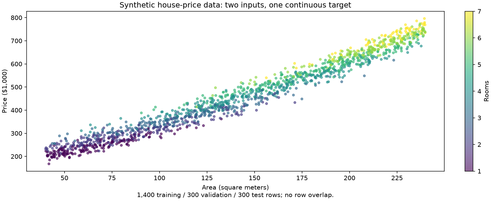
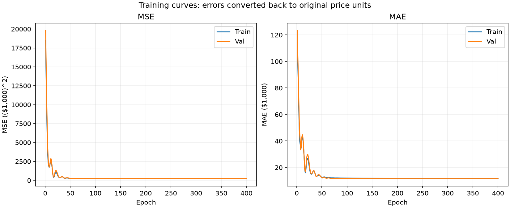
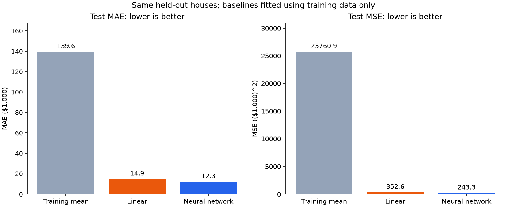

# Class 13: House-Price Regression

## Before You Start

**Classification** chooses a category; **regression** predicts a numerical value.
Here, the **features** are a house's area and number of rooms, and the **target**
is its price. The dataset is simulated for teaching, not collected from a real
housing market.

This network takes two inputs and produces one price value. Unlike digit
classification, it does not use Softmax: a price is not a set of category
probabilities. The program **standardizes** features and targets by subtracting
their training-set means and dividing by their training-set standard deviations.
This puts different numerical scales on a more comparable footing. Those
statistics come only from training data to avoid leaking held-out information.

### What This Experiment Shows

The model learns a relationship between area, rooms, and price. The checkpoint
with the lowest validation mean squared error is selected before test evaluation.
**MAE** is the average absolute prediction error. **MSE** is the average squared
error, so it penalizes large mistakes more strongly. Lower is better for both.
Reported MAE uses thousands of dollars: an MAE of 10 means an average absolute
error of $10,000; MSE uses squared thousand-dollar units.

The experiment compares the neural network with two **baselines**: always
predicting the training-set average price, and fitting a linear regression.
A more complicated model should earn its complexity rather than be assumed
superior.

### What to Look For

Compare the three models' test errors and the actual-versus-predicted plot:
points nearer the diagonal are more accurate. In the price curves, examine
area while holding room count fixed. Try prediction inputs within the training
range; predictions far outside familiar combinations are **extrapolation** and
may be unreliable. Even a good fit to this simulation is not a real property
valuation.

(code understanding is optional)

## Running

First run `.\start.bat install` (Windows) or `sh start.sh install` once from the
**repository root**. All lessons share its `.venv`; no per-class installation
or environment activation is needed when using the launchers.

Code, data and outputs are in `src/`. From this class directory (no arguments shows help only):
`.\start.bat training --epochs 20`.
Predict with `.\start.bat predict --area 120 --rooms 3`.
Use `.\start.bat generate` only if data is missing; replacing existing data
requires `--overwrite`. Run artifacts go to `src/runs/`.
Run automated tests with `.\start.bat test`.
On Linux/macOS use `sh start.sh` instead of `start.bat`.
See the [execution guide](../../readme.md).

## Homework

**Change one house feature (1-line edit).** After the normal experiment has
produced a saved checkpoint, run `.\start.bat predict` and note the price.
In `src/predict.py`, change the default area from 120 to 150:

```python
parser.add_argument("--area", type=float, default=150)
```

Run `.\start.bat predict` again without an `--area` override. Keep the same
checkpoint and room count. Did changing one input change the predicted price
without any retraining? This explores the learned relationship, not a real
property valuation. Restore the line afterward.

## Page 1: Area and Rooms to a Continuous Price



## Page 2: Training and Validation MAE/MSE



## Page 3: Price Curves and Actual vs. Predicted Prices


## Page 4: Mean Baseline, Linear Regression, and Neural Network


