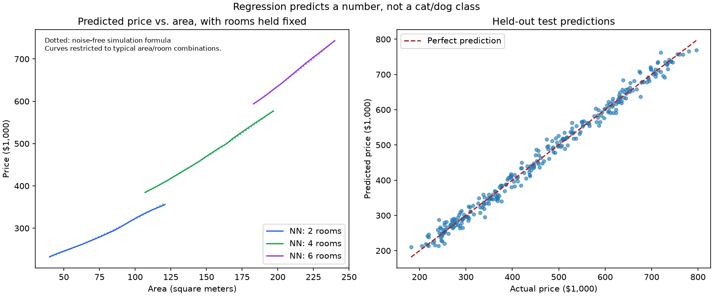

# Class 13: House-Price Regression

(code understanding is optional)

## Page 1: Area and Rooms to a Continuous Price

## Page 2: Training and Validation MAE/MSE

## Page 3: Price Curves and Actual vs. Predicted Prices

## Page 4: Mean Baseline, Linear Regression, and Neural Network

