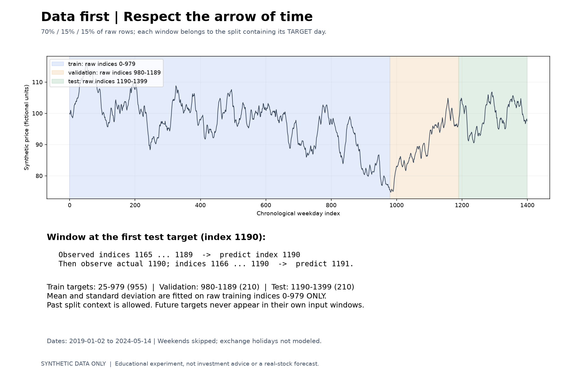
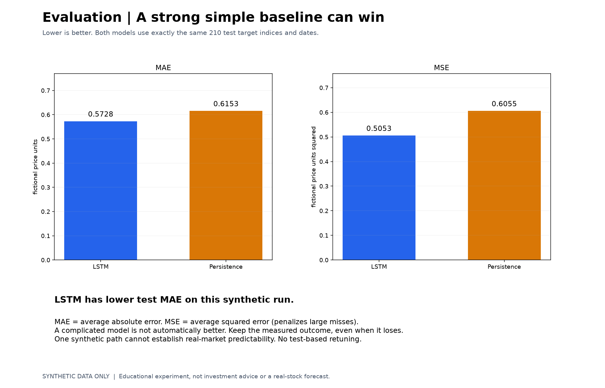

# Class 14: LSTM Forecasting with Synthetic Prices

## Before You Start

A **time series** is a sequence whose order matters, such as daily prices.
**Forecasting** predicts a later value using information available earlier.
Randomly mixing past and future targets can give an unrealistic evaluation;
this lesson keeps training, validation, and test targets in chronological order.

An **LSTM** (Long Short-Term Memory network) processes a sequence while carrying
an internal state that can retain useful information from earlier steps.
Here, a **lookback window** contains the previous 25 observed prices, and the
target is the next price. The data is an entirely synthetic, stock-like series,
not a real stock's history.

### What This Experiment Shows

The program assigns target dates to chronological 70% / 15% / 15% regions.
It scales values using only the training region's statistics and chooses the
saved checkpoint using validation error, not test performance. Every input
window contains observations strictly earlier than its target.

Evaluation uses **rolling one-step prediction**: after each target date passes,
its actual observed price may be part of a later input window. That is different
from predicting many future days at once by feeding the model its own guesses.
Validation and test windows may include earlier observations from a preceding
region; this is allowed because those observations are already in the past.

### What to Look For

Compare the LSTM with the **persistence baseline**, which simply predicts that
the next price equals the last observed price. Inspect MAE (average absolute
error), MSE (average squared error), and RMSE (the square root of MSE). Lower is
better; MAE and RMSE use the original fictional price units.
Two curves that look close are not enough: slowly changing prices can make
the simple baseline strong. The LSTM may or may not beat it. Keep the dataset
fixed and do not tune against test results. Success on one simulated sequence
does not establish real stock predictability or investment value.

(code understanding is optional)

## Running

First run `.\start.bat install` (Windows) or `sh start.sh install` once from the
**repository root**. All lessons share its `.venv`; no per-class installation
or environment activation is needed when using the launchers.

Code, the synthetic dataset and outputs are in `src/`. From this class directory (no arguments shows help only):
`.\start.bat training --epochs 20`.
Use `.\start.bat generate` only if data is missing; replacing frozen data
requires `--overwrite`. Run artifacts go to `src/runs/`.
Run automated tests with `.\start.bat test`; published-result reproduction
is skipped when no published run exists.
On Linux/macOS use `sh start.sh` instead of `start.bat`.
See the [execution guide](../../readme.md).

## Homework

**Try a shorter LSTM run (1-line edit).** In `main()` in
`src/train_model.py`, replace the existing `--epochs` argument definition with:

```python
parser.add_argument("--epochs", type=int, default=5)
```

Run `.\start.bat training` without an `--epochs` override. Inspect the new run's
`history.csv` for the five training and validation losses. Are they still
changing? Completing a training run does not guarantee that an LSTM beats the
simple persistence baseline. Keep the dataset and time split fixed, and do not
use test scores to choose a different epoch count. Restore the default afterward.

## Page 1: Hands-on LSTM Experiment


## Page 2: Chronological Data and Past-only Windows


## Page 3: Training and Validation Loss


## Page 4: Rolling One-step Test Predictions


## Page 5: LSTM and Persistence Metrics

