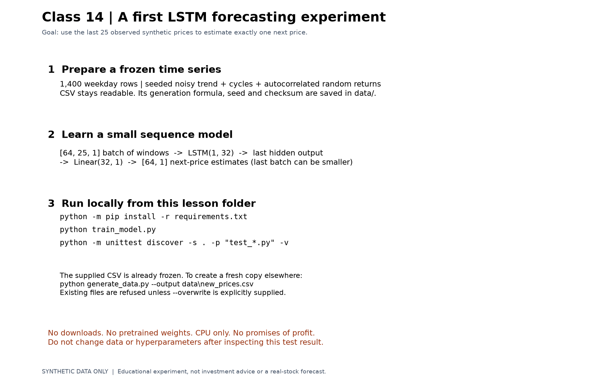
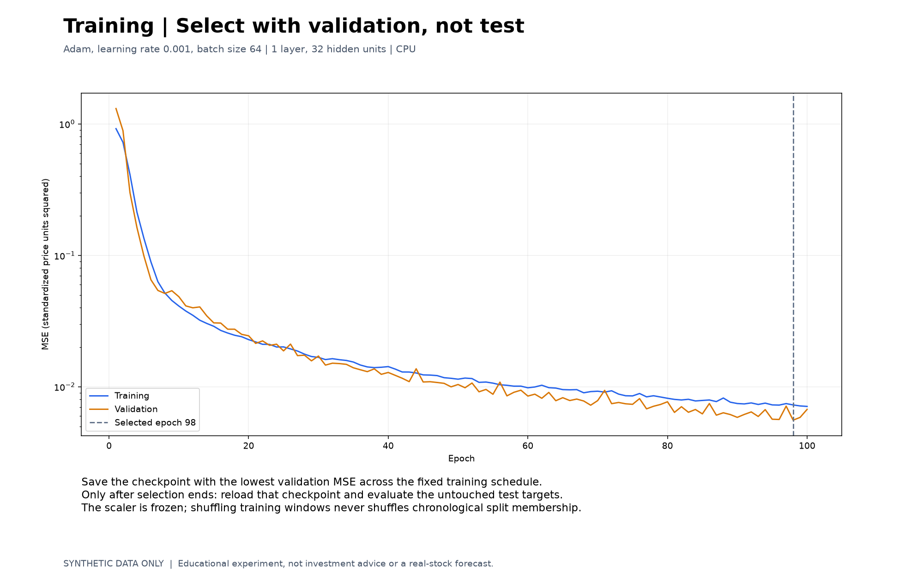
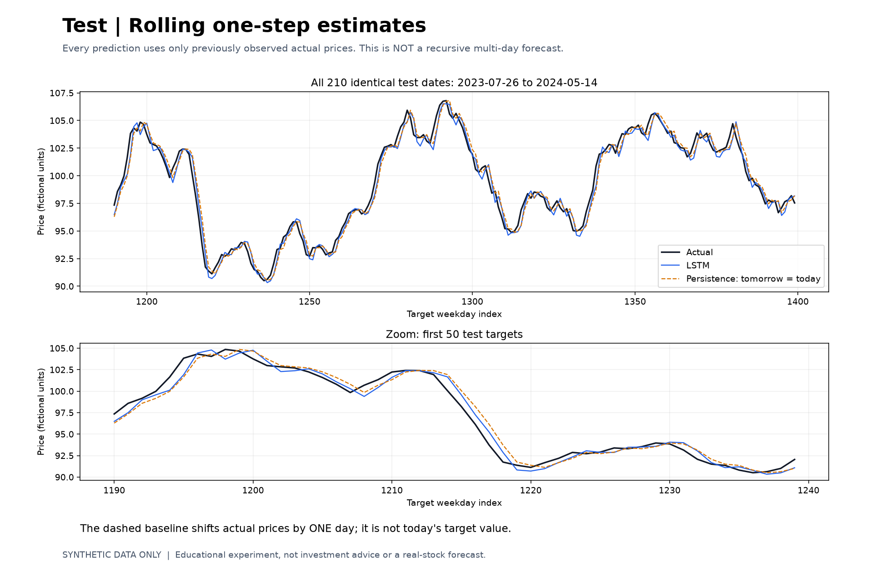

# Class 14: LSTM Forecasting with Synthetic Prices

(code understanding is optional)

## Page 1: Hands-on LSTM Experiment

## Page 2: Chronological Data and Past-only Windows

## Page 3: Training and Validation Loss

## Page 4: Rolling One-step Test Predictions

## Page 5: LSTM and Persistence Metrics

