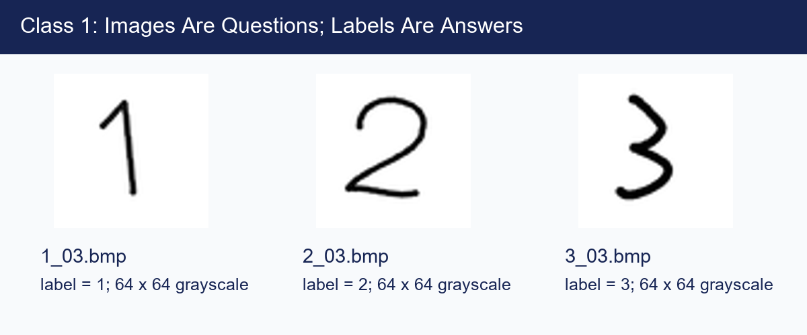

# Class 1: Dataset Preparation

## Before You Start

Machine learning means learning patterns from examples instead of writing a rule
for every possible input. In **supervised learning**, each example contains an
**input** and a **label**, the answer we want the model to learn. Here, the input
is an image of a handwritten digit, and the label is the digit it represents.
A **dataset** is a collection of these labeled examples.

An image is a grid of **pixels**, or numerical brightness values. The program
saves each drawing as a 64-by-64 grayscale image so later lessons receive inputs
of the same size and format. A filename such as `2_03.bmp` means "label 2,
sample 03." The label comes from the person preparing the example; it is not
automatically checked against the drawing.

### What This Experiment Shows

The app lets you browse examples, draw another digit, choose its label, and save
it. This is data collection, not model training: no digit recognizer is learned
in this class. Incorrect labels teach the wrong association later, and many
nearly identical examples do not represent the variety of real handwriting.

### What to Look For

Open the app and compare several examples with the same label. Notice differences
in stroke thickness, position, and writing style. If you add a sample, check that
its label matches the drawing and that it remains readable after resizing.
Ask yourself: would examples from just one writer prepare a model for a new
writer? Good data quality and representative examples matter before choosing
any model.

(code understanding is optional)

## Running

First run `.\start.bat install` (Windows) or `sh start.sh install` once from the
**repository root**. All lessons share its `.venv`; no per-class installation
or environment activation is needed when using the launchers.

Code and runtime assets are in `src/`. From this class directory (no arguments shows help only):
`.\start.bat app`.
On Linux/macOS use `sh start.sh` instead of `start.bat`.
See the [execution guide](../../readme.md) for environment setup.

## Homework

**Try a larger drawing canvas (1-line edit).** In `src/dataset_app.py`, change
`DRAW_SIZE = 256` to:

```python
DRAW_SIZE = 320
```

Run `.\start.bat app` and draw a digit. Notice the larger drawing area.
Leave `IMAGE_SIZE = 64` unchanged: why can the drawing canvas be larger while
the saved image still has the same input size for the neural network?
You do not need to save a new sample. Restore the line afterward.

## Page 1: Handwritten Digit Samples


