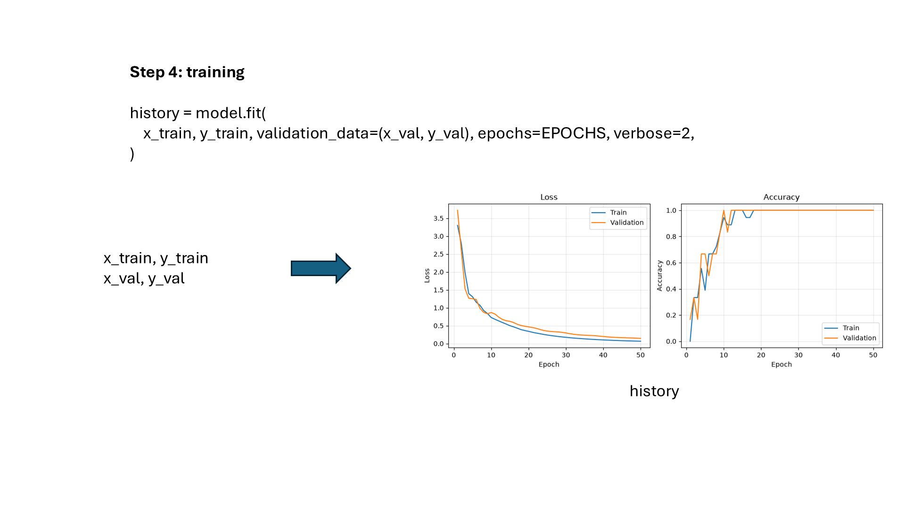
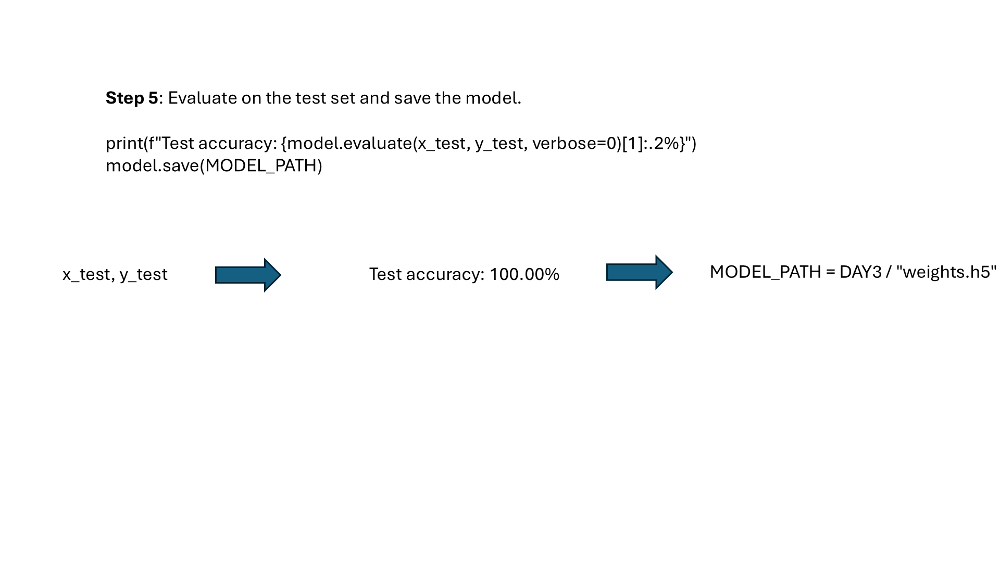

# Class 3: Model Training

## Before You Start

**Classification** means choosing a category, such as which digit appears in an
image. A **model** is a mathematical rule that turns input numbers into output
scores. Its **parameters**, also called weights and biases, are numbers adjusted
during training so its predictions better match the labels.

This neural network reads a 64-by-64 image as a list of 4,096 brightness values,
scaled from 0-255 to 0-1. A hidden layer combines them into 32 intermediate
values. Its **ReLU** activation keeps positive values and sets negative values
to zero, allowing the network to learn more than a single linear rule.
The output layer has ten scores, one for each digit. **Softmax** converts these
scores into probabilities that sum to one.

### What This Experiment Shows

The program learns from Class 2's training images. **Loss** measures how poorly
the predicted probabilities match the correct labels; lower is better.
**Accuracy** is the fraction of predictions with the correct label; higher is
better. An **optimizer** updates the parameters to reduce loss, and an **epoch**
is one pass through the training examples. Validation examples monitor progress
but do not directly update the parameters.

### What to Look For

Run training and inspect `src/training_curves.png`. Does training loss fall?
Does validation improve too, or do the curves move apart? Loss can improve while
accuracy stays unchanged because probabilities can change without changing the
winning digit. The script evaluates the test set after training and saves the
model for Class 4. Ten output categories do not mean the tiny supplied dataset
contains enough examples to recognize all ten digits reliably.

(code understanding is nice to have, but not required for this class)

## Running

First run `.\start.bat install` (Windows) or `sh start.sh install` once from the
**repository root**. All lessons share its `.venv`; no per-class installation
or environment activation is needed when using the launchers.

Code and weights are in `src/`. From this class directory (no arguments shows help only):
`.\start.bat training`.
Training reads Class 2's `src/` splits and overwrites this lesson's
`src/weights.h5` and `src/training_curves.png`.
On Linux/macOS use `sh start.sh` instead of `start.bat`.
See the [execution guide](../../readme.md).

## Homework

**Try fewer training epochs (3-line edit).** In `src/train_model.py`, replace
the existing epoch and output-path assignments with:

```python
EPOCHS = 5
MODEL_PATH = CLASS3 / "homework_weights.h5"
PLOT_PATH = CLASS3 / "homework_training_curves.png"
```

Run `.\start.bat training` and inspect the new plot. Compare the first and last
training/validation losses: did five passes through the data change them?
The separate filenames protect the model used by later classes. Keep the
dataset fixed and restore the three lines afterward.

## Page 1: From Pixels to a Neural Network


## Page 2: Loading Images and Labels


## Page 3: Training and Learning Curves



## Page 4: Testing and Saving the Model


