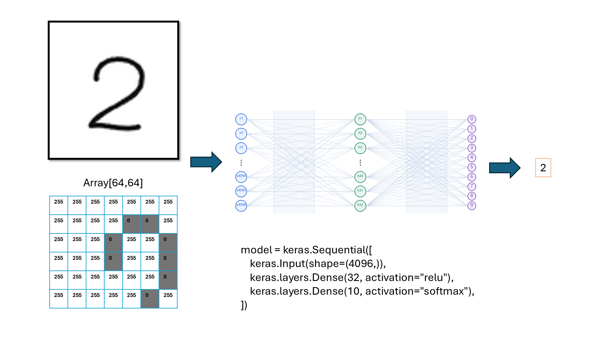
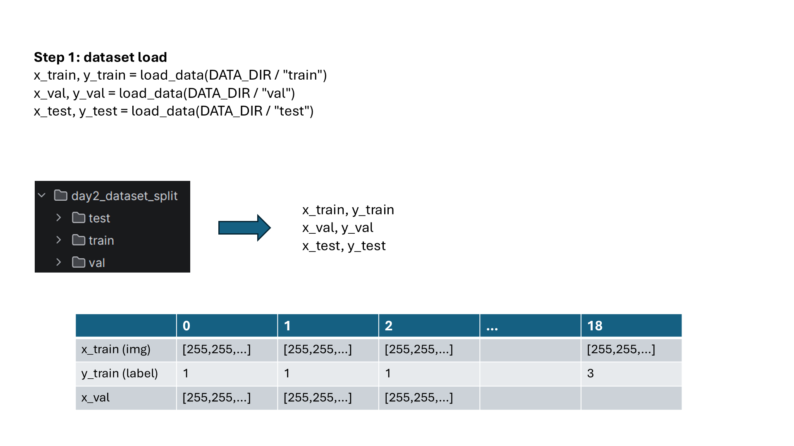

# Class 3: Model Training

(code understanding is nice to have, but not required for this class)

## Page 1: From Pixels to a Neural Network

## Page 2: Loading Images and Labels

## Page 3: Training and Learning Curves

## Page 4: Testing and Saving the Model

