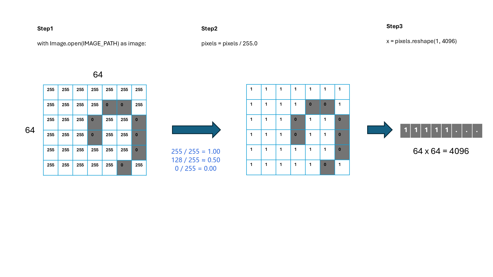
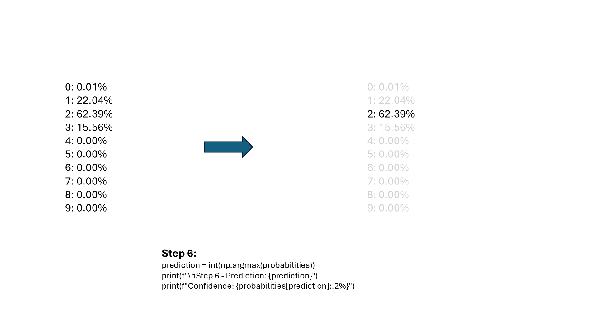

# Class 4: Model Prediction

## Before You Start

**Training** adjusts a model using labeled examples. **Inference**, also called
prediction, applies an already trained model to an input without updating its
parameters. A saved model lets us separate these two activities: we can train
once, then load the result to make predictions later.

The model expects numbers prepared in the same way as during training.
This **preprocessing** includes converting the image to grayscale, resizing it
to 64 by 64 pixels, scaling brightness values to 0-1, and arranging them as a
list of 4,096 numbers. Different sizes, backgrounds, or handwriting placement
can change predictions even when a person sees the same digit.

### What This Experiment Shows

The desktop app loads a model and predicts a digit you draw. The command-line
example loads Class 3's saved model, processes a Class 2 test image, prints ten
digit probabilities, and chooses the largest. The model uses the image pixels,
not the answer encoded in its filename.

### What to Look For

Try a clear drawing similar to the training examples, then change its size or
position. Does the prediction remain stable? In the command-line output, compare
the largest probability with the next largest. A high reported probability is
not proof of correctness or a guaranteed real-world success rate. An unfamiliar
input can still receive a confident wrong answer. Saving a new sample in Class 1
also does not update this model automatically; the data must be split and the
model trained again.

(code understanding is nice to have ONLY for inf_model.py)

## Running

First run `.\start.bat install` (Windows) or `sh start.sh install` once from the
**repository root**. All lessons share its `.venv`; no per-class installation
or environment activation is needed when using the launchers.

Code is in `src/`. From this class directory (no arguments shows help only):
`.\start.bat app` for the desktop app,
or `.\start.bat predict` for the command-line prediction.
Both use Class 3's `src/` model location; the command-line example reads
Class 2's `src/test/2_03.bmp`.
On Linux/macOS use `sh start.sh` instead of `start.bat`.
See the [execution guide](../../readme.md).

## Homework

**Predict another image (1-line edit).** In `src/inf_model.py`, change
`IMAGE_PATH` to another supplied test image:

```python
IMAGE_PATH = STUDY / "class2_dataset_split" / "src" / "test" / "1_01.bmp"
```

Run `.\start.bat predict` and compare the probabilities with the original
`2_03.bmp` example. Did the most likely digit change even though the model
weights stayed the same? This is inference, not another training step.
If you previously replaced the sample dataset, choose a BMP that exists in its
test folder instead. Restore the original path afterward.

## Page 1: Prediction Overview


## Page 2: Image Preprocessing



## Page 3: Loading the Model and Predicting Probabilities


## Page 4: Selecting the Predicted Digit


