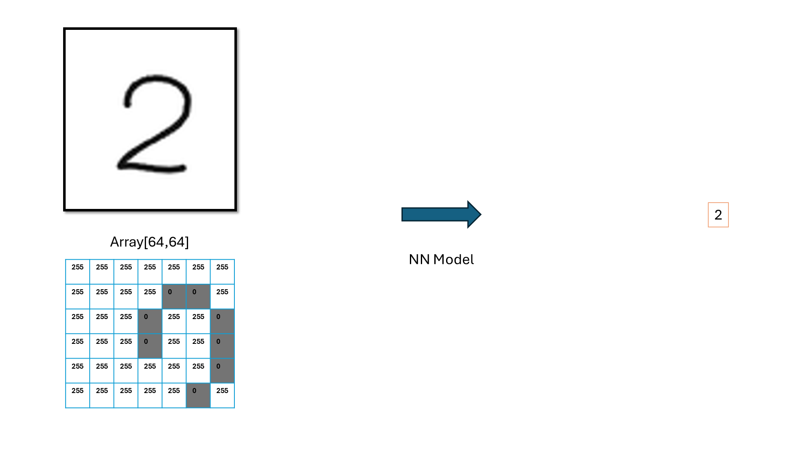
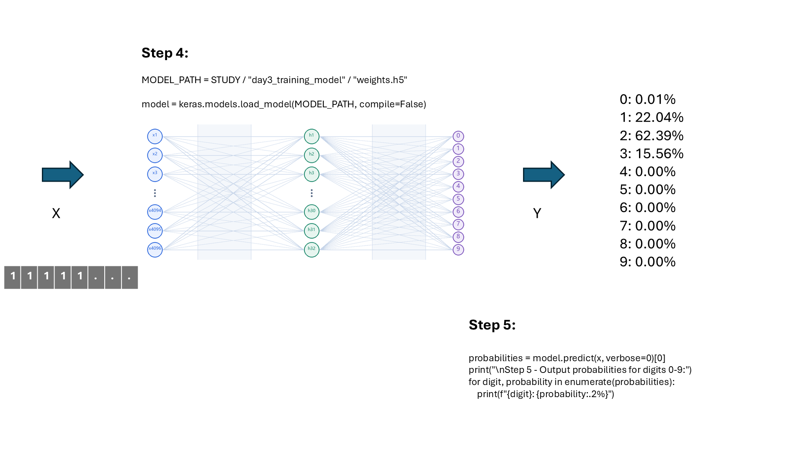

# Class 4: Model Prediction

(code understanding is nice to have ONLY for inf_model.py)

## Page 1: Prediction Overview

## Page 2: Image Preprocessing

## Page 3: Loading the Model and Predicting Probabilities

## Page 4: Selecting the Predicted Digit

