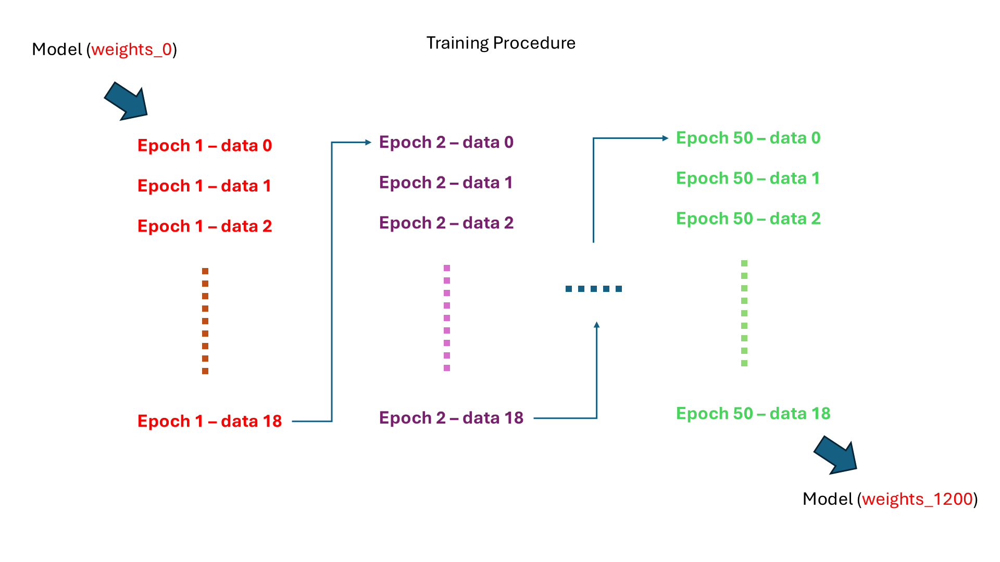
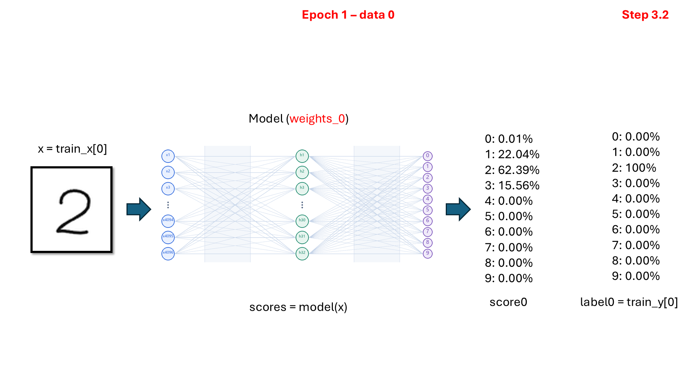
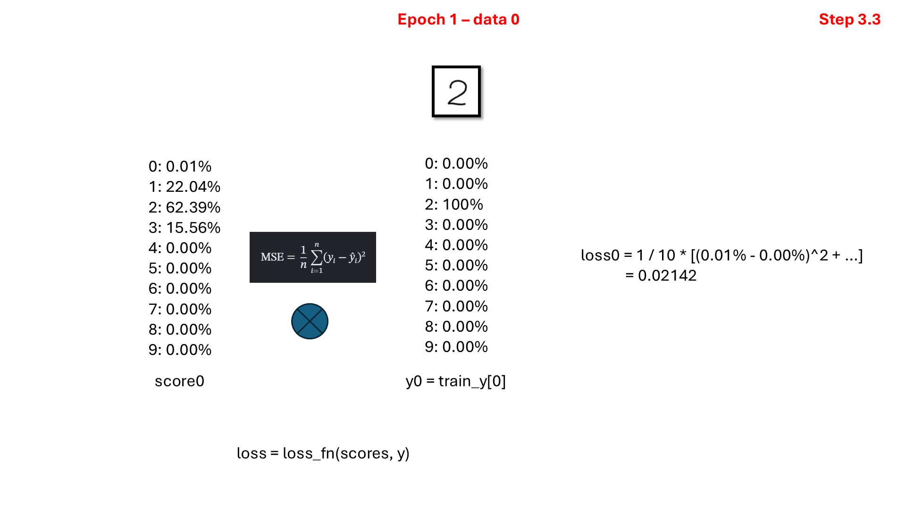
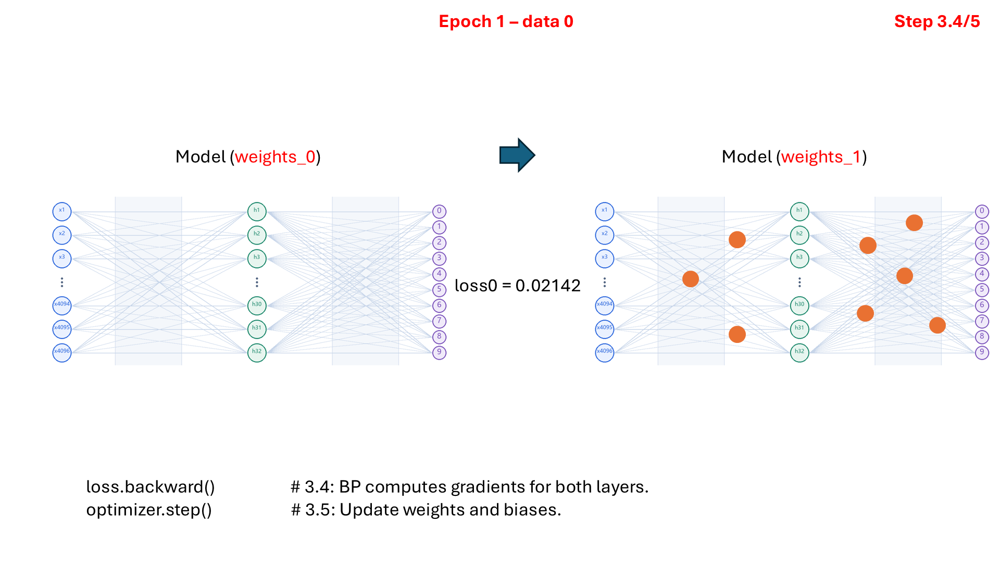
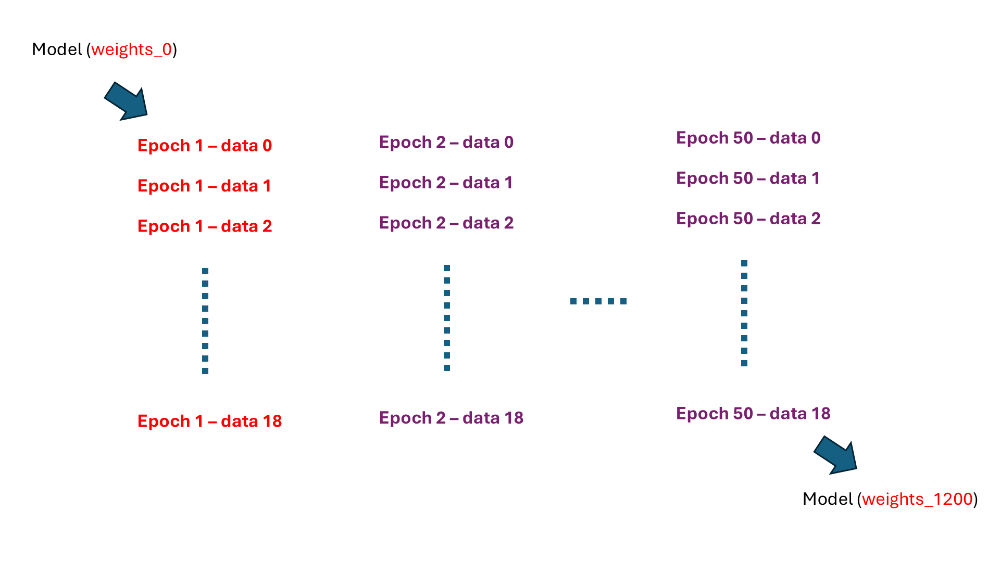
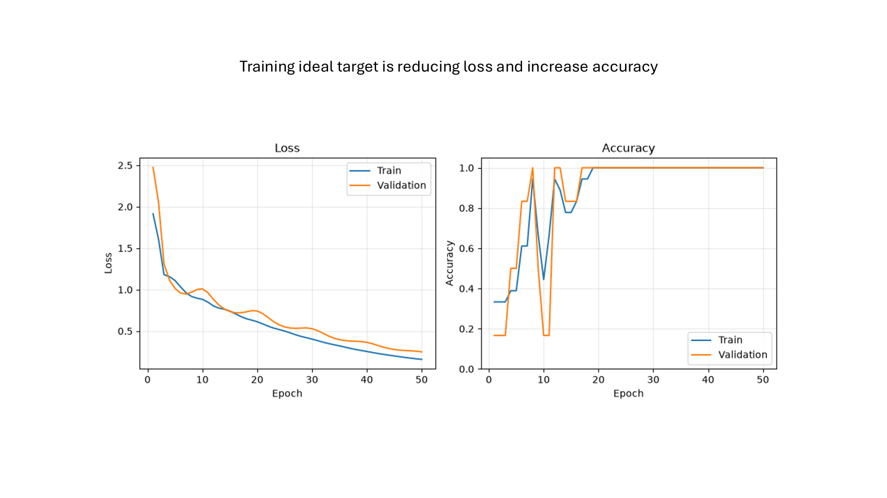

# Class 5: The Training Loop

(code understanding is optional)

## Page 1: Training Overview

## Page 2: Forward Pass

## Page 3: Loss Calculation

## Page 4: Backpropagation and Parameter Updates

## Page 5: The Next Training Sample

## Page 6: Calculating the Next Loss

## Page 7: Updating Parameters Again

## Page 8: Repeating the Training Steps

## Page 9: Training Across Epochs

## Page 10: Training and Validation Curves

