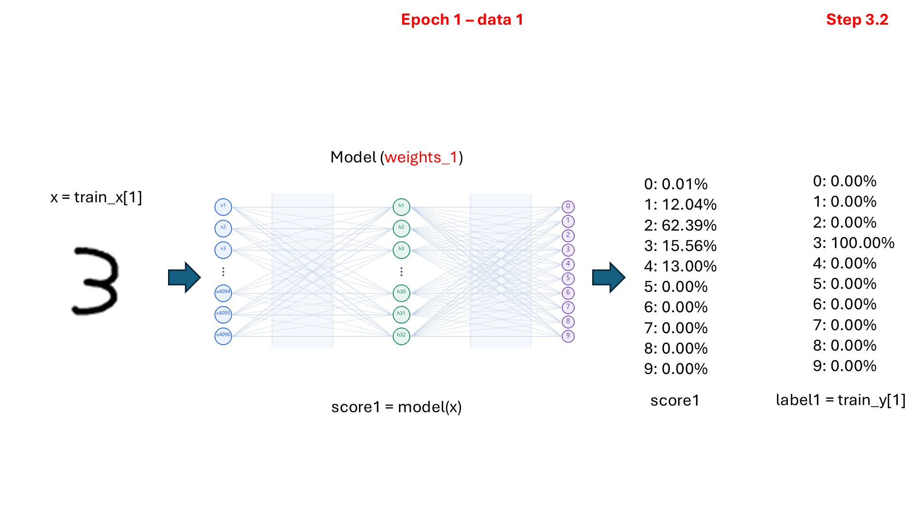
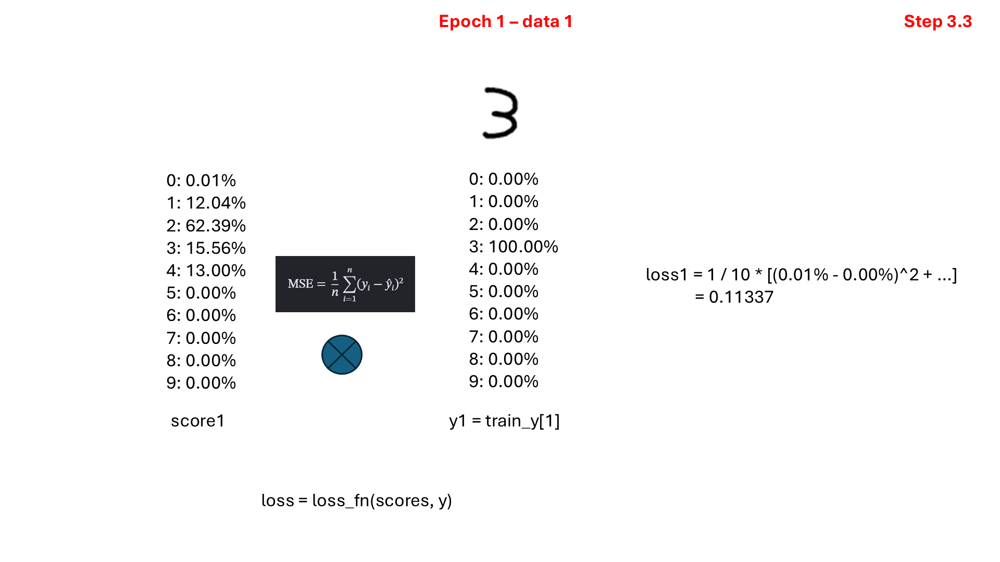
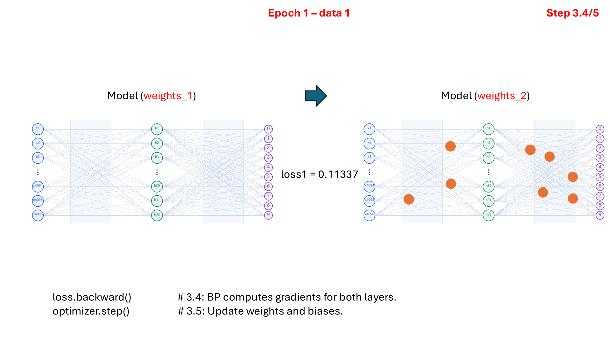
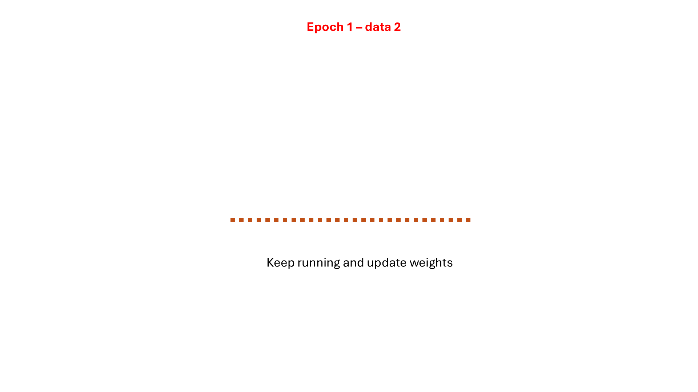

# Class 5: The Training Loop

## Before You Start

Training is a repeated cycle of predicting, measuring error, and adjusting a
model. This lesson makes that cycle visible instead of hiding it inside a
high-level training command. It uses the same digit task and
4,096-input, 32-hidden-unit, ten-output network shape as Class 3, implemented
with PyTorch.

A **forward pass** computes predictions from the current weights. A **loss
function** compares those predictions with the correct labels. **Backpropagation**
computes gradients: numbers describing how the loss changes when a parameter
changes. The **optimizer** uses those gradients to update the parameters.
The **learning rate** controls the update scale; a larger value is not
automatically faster or better.

### What This Experiment Shows

Each epoch clears old gradients, makes a forward pass, calculates loss,
backpropagates, and updates the weights. This script uses all training images
in one batch, so there is one optimizer update per epoch. Other programs may
use many smaller batches and therefore many updates in an epoch.

The network outputs raw scores called **logits**. PyTorch's cross-entropy loss
handles the probability-related calculation internally, so an extra Softmax
layer is not needed here. Training and validation metrics are measured after
each update without computing gradients.

### What to Look For

Follow one epoch's printed loss and accuracy, then compare early and later
epochs in `src/training_curves.png`. The goal is not simply to repeat updates
forever: training improvement without validation improvement can indicate poor
generalization. The saved `weights.pt` contains learned weights, not the
training images; using it later also requires the matching network structure
and preprocessing.

(code understanding is optional)

## Running

First run `.\start.bat install` (Windows) or `sh start.sh install` once from the
**repository root**. All lessons share its `.venv`; no per-class installation
or environment activation is needed when using the launchers.

Code and weights are in `src/`. From this class directory (no arguments shows help only):
`.\start.bat training`.
Training reads Class 2's `src/` splits and overwrites this lesson's
`src/weights.pt` and `src/training_curves.png`.
On Linux/macOS use `sh start.sh` instead of `start.bat`.
See the [execution guide](../../readme.md).

## Homework

**Try a smaller learning rate (3-line edit).** After the normal experiment,
change these existing assignments in `src/train_model.py`:

```python
LEARNING_RATE = 0.0001
MODEL_PATH = CLASS5 / "homework_weights.pt"
PLOT_PATH = CLASS5 / "homework_training_curves.png"
```

Run `.\start.bat training`. Compare the new training-loss curve with the
original `src/training_curves.png`: does the smaller update scale change how
quickly loss decreases? Keep the epoch count and data unchanged. The homework
filenames preserve the original outputs; restore the three lines afterward.

Reading more from https://www.3blue1brown.com/lessons/neural-networks

## Page 1: Training Overview


## Page 2: Forward Pass


## Page 3: Loss Calculation


## Page 4: Backpropagation and Parameter Updates


## Page 5: The Next Training Sample



## Page 6: Calculating the Next Loss



## Page 7: Updating Parameters Again



## Page 8: Repeating the Training Steps



## Page 9: Training Across Epochs


## Page 10: Training and Validation Curves


