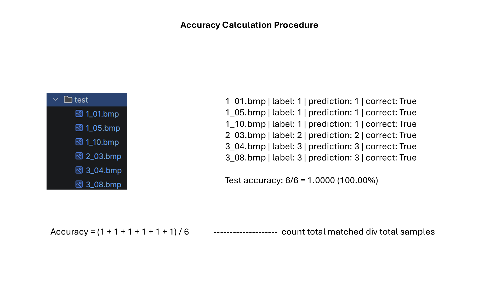
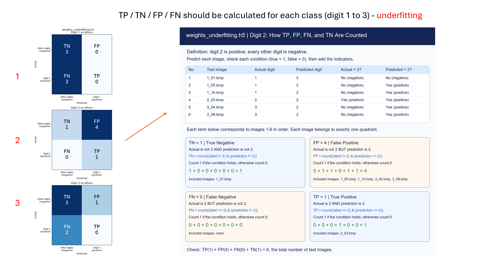
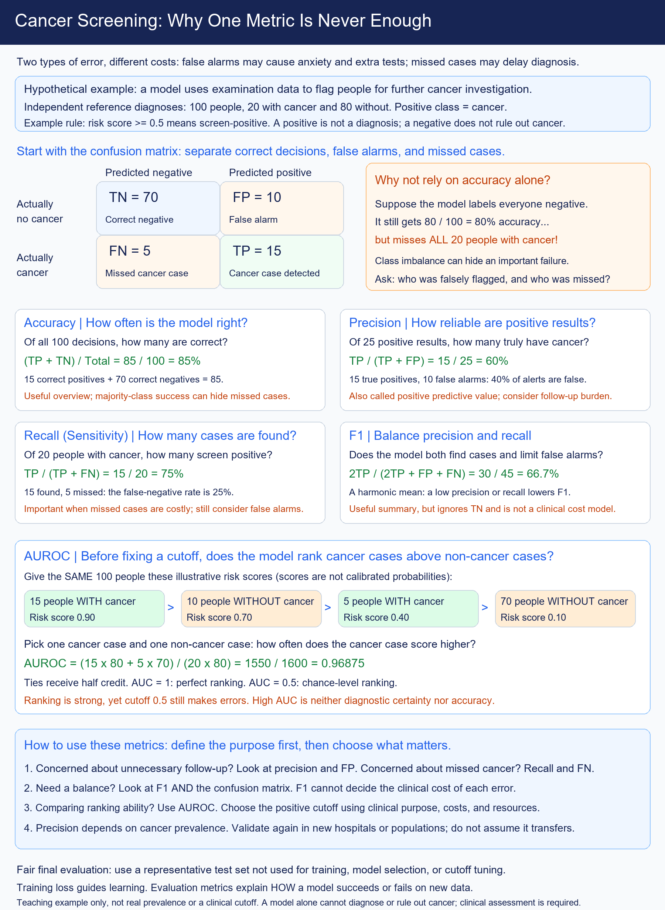

# Class 6: Model Evaluation

(code understanding is optional)

## Page 1: Accuracy

## Page 2: Accuracy of the Underfitting Model

## Page 3: One-vs-Rest Confusion Matrices

## Page 4: Confusion Matrices of the Underfitting Model

## Page 5: Precision

## Page 6: Recall

## Page 7: F1 Score

## Page 8: AUROC

## Page 9: Cancer Screening Metrics

