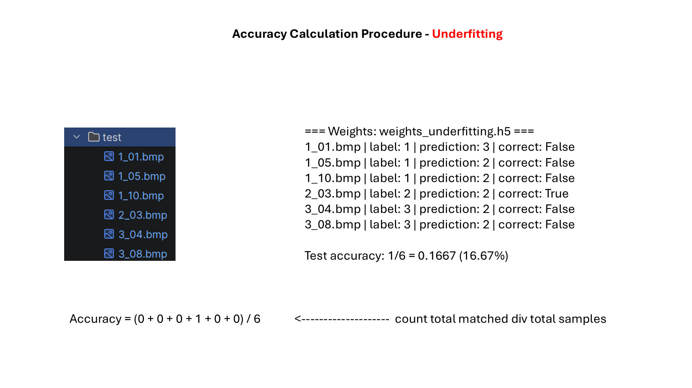
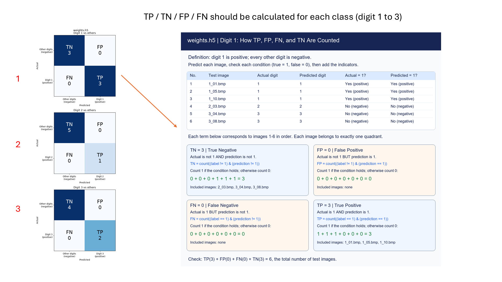
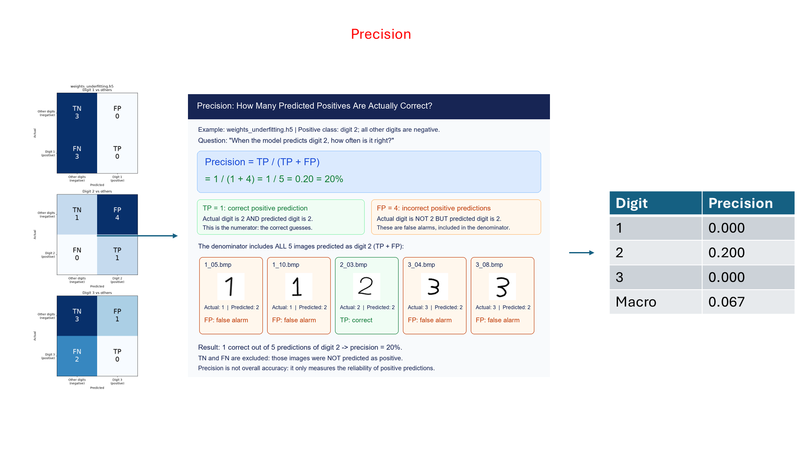
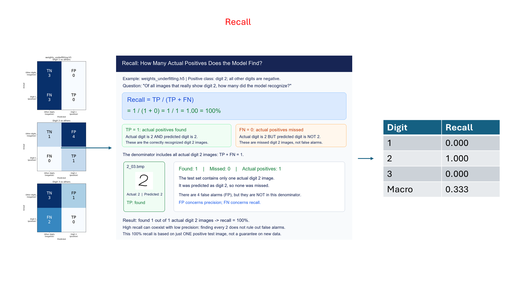
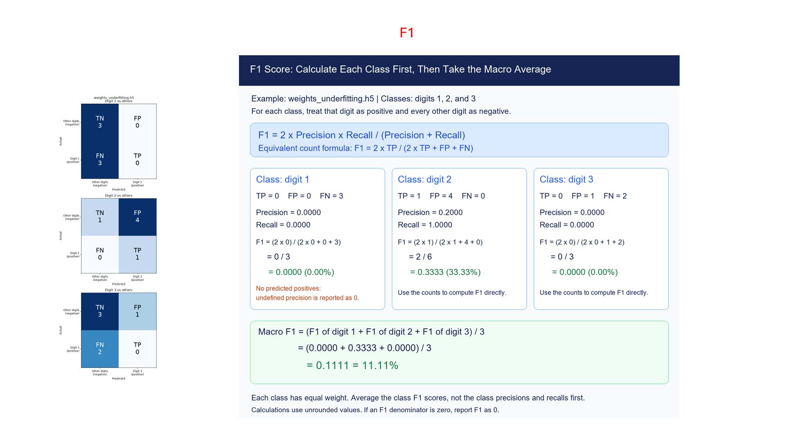
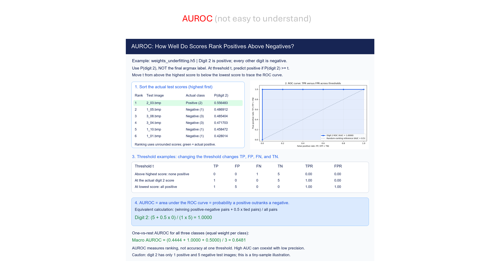

# Class 6: Model Evaluation

## Before You Start

**Accuracy** answers "What fraction of predictions were correct?" It is useful,
but it does not explain which mistakes a model makes. For example, always
predicting the majority category can produce high accuracy while missing every
example of a rare category.

A **confusion matrix** counts actual labels against predicted labels. To study
one digit, treat that digit as **positive** and every other digit as **negative**.
For digit 2, a **true positive** is a real 2 predicted as 2; a **false positive**
is another digit predicted as 2; a **false negative** is a real 2 predicted as
something else; and a **true negative** is another digit not predicted as 2.

**Precision** asks "Of the predictions called positive, how many were right?"
**Recall** asks "Of the actual positives, how many were found?" **F1** combines
precision and recall using their harmonic mean, so a low value in either hurts
the result. **AUROC** measures how well positive examples rank above negative
ones using model probabilities across possible thresholds. It is not the
accuracy of the single largest-probability prediction.

### What This Experiment Shows

The programs evaluate Class 3's normal and underfitting models on the same
test images. An **underfitting** model has not learned enough useful structure.
You can compare accuracy, one-digit-versus-rest confusion matrices, and
precision/recall/F1/AUROC. The metric report gives digits 1, 2, and 3 equal weight
in a **macro average**, rather than weighting them by sample count.

### What to Look For

Pick a digit and trace its false positives and false negatives before reading
its metrics. The scripts report undefined precision/recall/F1 ratios as zero;
AUROC is unavailable when a digit has no positive or no negative test examples.
A tiny test set makes scores unstable. Use the screening slides to consider why
different mistakes matter, but do not interpret this digit experiment as
evidence that a model is safe for medical diagnosis.

(code understanding is optional)

## Running

First run `.\start.bat install` (Windows) or `sh start.sh install` once from the
**repository root**. All lessons share its `.venv`; no per-class installation
or environment activation is needed when using the launchers.

Code and evaluation plots are in `src/`. From this class directory (no arguments shows help only):
`.\start.bat test` to run all three evaluation demos.
Use `accuracy`, `metrics` or `confusion` instead of `test` to run just one.
These are model evaluations, not unittest tests. They read Class 3's
`src/weights.h5` and `src/weights_underfitting.h5`, and Class 2's `src/test`.
Confusion matrices are saved in `src/samples/`.
On Linux/macOS use `sh start.sh` instead of `start.bat`.
See the [execution guide](../../readme.md).

## Homework

**Focus on one digit (2-line edit).** In `src/test_metrics.py`, change the
`DIGITS` assignment to:

```python
DIGITS = (2,)
```

Also replace the final `print(...)` message that says the macro average covers
digits 1, 2, and 3 with:

```python
print("Macro averages digit 2 only; AUROC needs positive and negative samples.")
```

Run `.\start.bat metrics`. Compare the digit 2 row with the macro row:
why are their values now equal? The weights and predictions have not changed;
only the categories included in the summary have changed. Restore both lines.

## Page 1: Accuracy


## Page 2: Accuracy of the Underfitting Model



## Page 3: One-vs-Rest Confusion Matrices



## Page 4: Confusion Matrices of the Underfitting Model


## Page 5: Precision



## Page 6: Recall



## Page 7: F1 Score



## Page 8: AUROC



## Page 9: Cancer Screening Metrics


