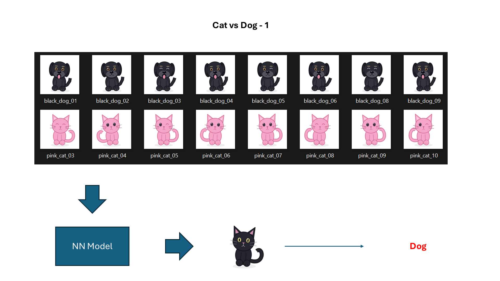
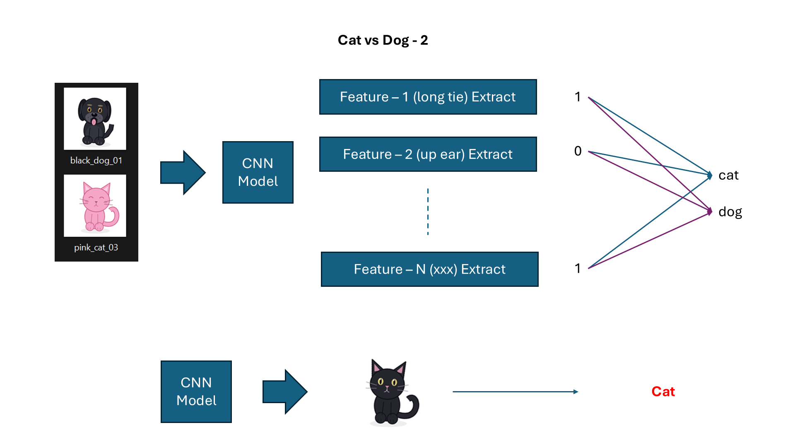

# Class 7: Feature Extraction

## Before You Start

A **feature** is a numerical description of an input. A model can only learn
from information its features retain. If we describe an animal only by its
average color, we remove the positions of its ears, legs, and other shapes.

A **shortcut** is an easy association that works in the training examples but
is not the intended rule. Here, training images contain pink cats and black dogs.
Color is therefore a tempting shortcut, but "black means dog" will fail on a
black cat. Good training accuracy does not tell us whether the model learned
animal shape or a convenient color association.

### What This Experiment Shows

The first program reduces each image to three average foreground color values
and trains a small classifier. The second removes color and keeps a spatial
foreground mask. A **convolutional neural network (CNN)** then uses small,
repeated filters to learn local spatial patterns from that mask.
Both programs predict the same held-out black cat, without using its filename
as an input feature.

### What to Look For

Run the color-only experiment, then the CNN experiment, and compare the black
cat's predicted label and probabilities. Ask what information each model could
actually see. This comparison changes both preprocessing and model structure:
the CNN receives a color-free mask, while the first model receives only color.
It does not prove that CNNs automatically ignore color. A CNN given RGB images
can also learn shortcuts, and success on a few controlled cartoons does not
establish recognition of real cats and dogs.

(code understanding is optional)

## Running

First run `.\start.bat install` (Windows) or `sh start.sh install` once from the
**repository root**. All lessons share its `.venv`; no per-class installation
or environment activation is needed when using the launchers.

Code, images and weights are in `src/`. From this class directory (no arguments shows help only):
`.\start.bat training` for color-only features
or `.\start.bat cnn` for shape-based CNN features.
The programs overwrite `src/weights.pt` and `src/weights_cnn.pt`, respectively.
On Linux/macOS use `sh start.sh` instead of `start.bat`.
See the [execution guide](../../readme.md).

## Homework

**Try a very short color-only training run (2-line edit).** In
`src/train_model.py`, change these existing assignments:

```python
EPOCHS = 5
MODEL_PATH = CLASS7 / "homework_weights.pt"
```

Run `.\start.bat training` and compare the first and last printed training
losses. Then look at the black-cat prediction. Does lower training loss
necessarily mean the model learned shape rather than a color shortcut?
Do not change the images or tune settings to fix that held-out example.
Restore both lines afterward; the original weights remain untouched.

Try more from https://playground.tensorflow.org/

## Page 1: Color-Based Classification



## Page 2: CNN Feature Extraction


