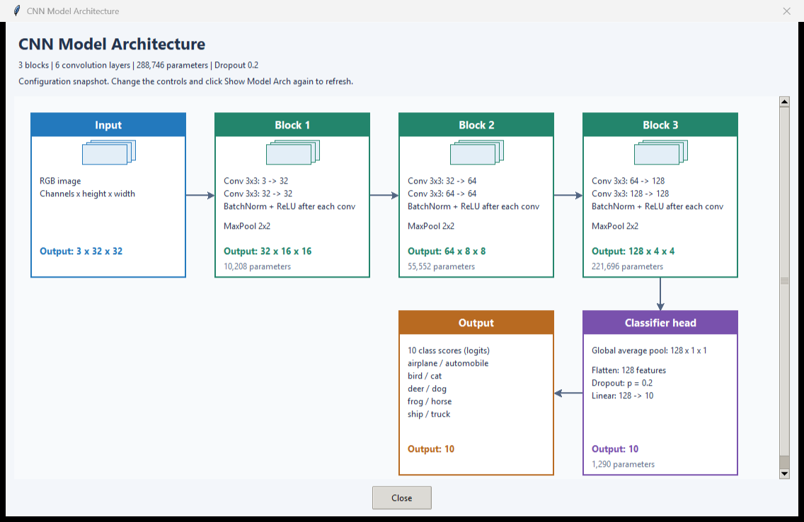

# Class 8: Interactive CNN Training

## Before You Start

A **convolutional neural network (CNN)** learns small filters that look for
patterns across an image. Early layers can learn local patterns such as edges;
later layers can combine patterns into more complex features. **Channels** are
the feature maps produced by a layer. **Pooling** reduces their spatial size,
so later layers work with more compact representations.

The model's weights are learned from data. **Hyperparameters** are choices you
make before training, such as layer count, learning rate, and batch size.
An **epoch** is one pass through the selected training examples; a **batch** is
the group used for one update. More layers or channels usually mean more
parameters, memory use, and computation, not guaranteed better predictions.

### What This Experiment Shows

The GUI trains a configurable CNN on CIFAR-10, a dataset with ten categories
such as cats, ships, and airplanes. It splits the official training data into
training and validation groups, with optional smaller sample limits.
Its live validation scores are not a final score on the official test set.

You can also try **regularization**, methods intended to reduce reliance on
overly specific patterns. Dropout randomly disables some activations during
training, weight decay discourages large weights, and data augmentation creates
training variations using crops and flips. These methods can help, but are not
guarantees of better validation performance.

### What to Look For

Start with a small configuration and watch training and validation curves.
Then change just one setting, keeping the dataset limits and seed fixed where
possible. Compare validation performance as well as runtime and parameter count.
Does a larger model help, or only fit training examples better? A random seed
helps make comparisons repeatable, but does not guarantee identical results
across all devices and software environments.

(code understanding is optional)

## Running

First run `.\start.bat install` (Windows) or `sh start.sh install` once from the
**repository root**. All lessons share its `.venv`; no per-class installation
or environment activation is needed when using the launchers.

Code and runtime assets are in `src/`. From this class directory (no arguments shows help only):
`.\start.bat app` (or `.\start.bat training`).
Start training inside the GUI; `training.py` is not a standalone CLI.
The first training run may download CIFAR-10 into `src/data/`;
run artifacts are stored in `src/runs/`.
Run automated tests with `.\start.bat test`.
On Linux/macOS use `sh start.sh` instead of `start.bat`.
See the [execution guide](../../readme.md).

## Homework

**Try a narrower CNN (1-line edit).** First open the app and note its parameter
count, then close it. In the `Config` class in `src/training.py`, change
`base_channels: int = 32` to:

```python
base_channels: int = 8
```

Run `.\start.bat app` again without changing other settings or selecting a
preset. Compare the displayed parameter count. Why does a narrower network
have fewer learned numbers even though the task still has ten classes?
You do not need to start training or download data. Restore the line afterward.

## Page 1: CNN Architecture, Hyperparameters, and Live Learning Curves


## Page 2: Model Architecture


