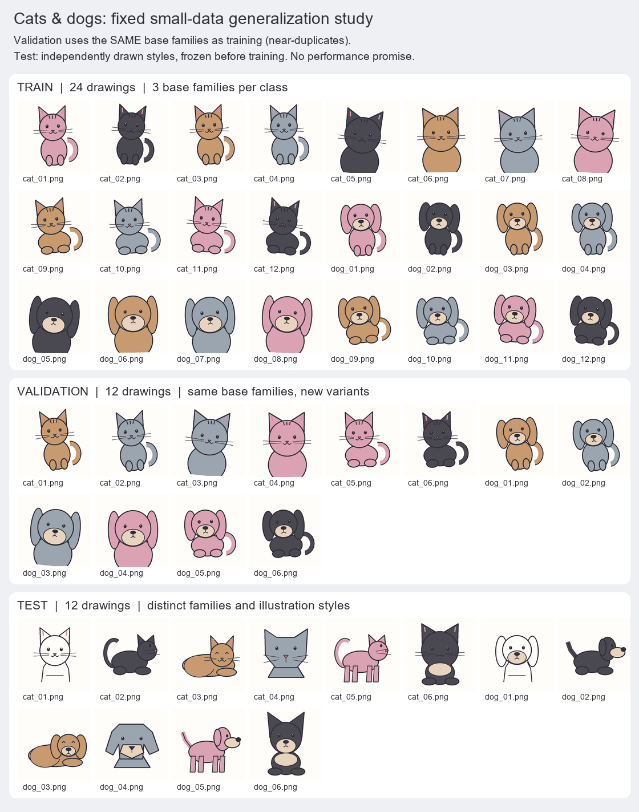
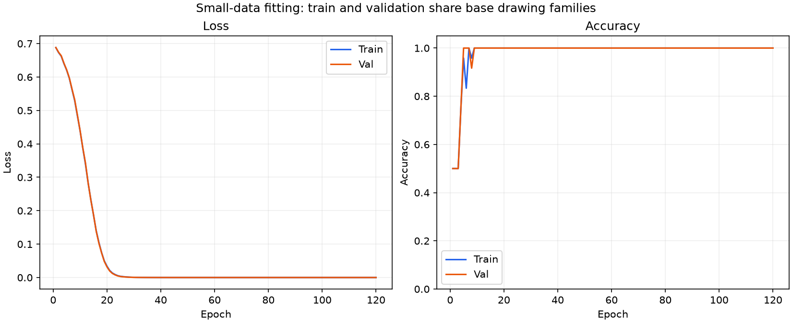

# Class 9: Overfitting and Generalization

(code understanding is optional)

## Page 1: Shared-Family Train/Validation Data and New Test Styles

## Page 2: Training and Validation Curves

## Page 3: Accuracy, Precision, Recall, and F1

## Page 4: Predictions on Every Test Image

