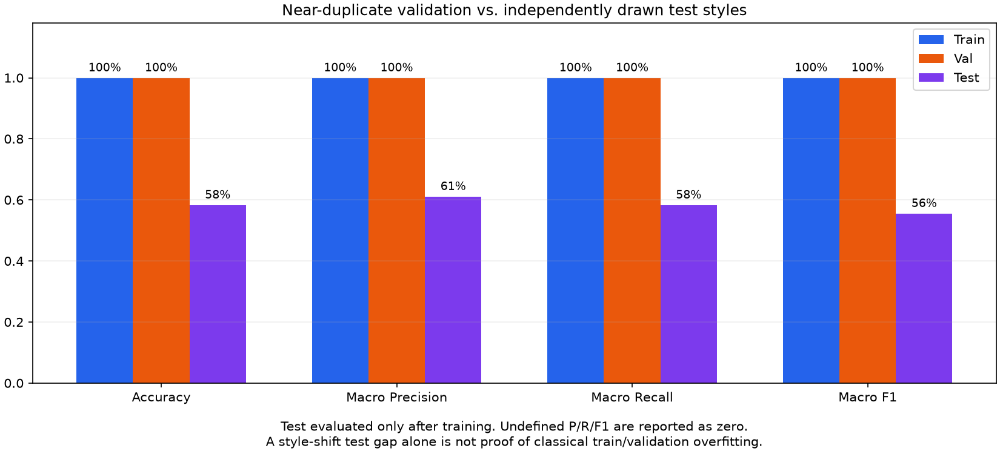
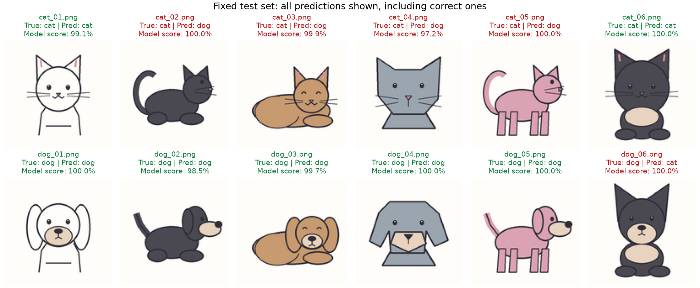

# Class 9: Overfitting and Generalization

## Before You Start

**Generalization** means applying what was learned to new examples.
**Overfitting** happens when a model fits training-specific details that do not
transfer well. One warning sign is training performance continuing to improve
while performance on a suitably independent validation set worsens.
An **underfitting** model, in contrast, has not captured enough structure even
in its training data.

A separate problem is **distribution shift**: new inputs differ from those used
for learning. A model trained on one drawing style may struggle with another.
Poor performance on a changed test distribution does not, by itself, prove
the classic training-versus-validation pattern of overfitting.

### What This Experiment Shows

A relatively large CNN learns from a tiny, fixed cartoon cat/dog dataset.
Training and validation drawings intentionally share base drawing families;
their small variations make validation easier than genuinely new drawing
styles. The test images use independently drawn families and a shifted style.
Different files are therefore not necessarily independent kinds of examples.

The program deliberately omits dropout, weight decay, and online augmentation.
It runs the requested number of epochs, saves the final model, and only then
evaluates test images. It does not automatically stop early or choose a model
using test results.

### What to Look For

Inspect the dataset overview, training/validation curves, and final metrics for
all three splits. Do strong training and validation scores carry over to the
new styles? Examine individual mistakes instead of only the average.
Do not expect a particular accuracy gap on every run. Keep test results as an
honest final check rather than repeatedly changing data or settings to improve
them. This lesson illustrates both model fitting and how an overly similar
validation set can give misleading reassurance.

(code understanding is optional)

## Running

First run `.\start.bat install` (Windows) or `sh start.sh install` once from the
**repository root**. All lessons share its `.venv`; no per-class installation
or environment activation is needed when using the launchers.

Code, the frozen dataset and outputs are in `src/`. From this class directory (no arguments shows help only):
`.\start.bat training --epochs 20`.
Use `.\start.bat generate` only if the dataset is missing; replacing existing
data requires an explicit `--overwrite`. Run artifacts go to `src/runs/`.
Run automated tests with `.\start.bat test`.
On Linux/macOS use `sh start.sh` instead of `start.bat`.
See the [execution guide](../../readme.md).

## Homework

**Try only five epochs (1-line edit).** In `main()` in `src/train_model.py`,
replace the existing `--epochs` argument definition with:

```python
parser.add_argument("--epochs", type=int, default=5)
```

Run `.\start.bat training` without an `--epochs` override. Watch the five
training/validation updates: are the losses still changing at the end?
A short run may not have learned enough yet, but that is different from proving
overfitting. Keep the frozen data unchanged and do not choose another setting
by chasing the reported test score. Restore the default afterward.

## Page 1: Shared-Family Train/Validation Data and New Test Styles


## Page 2: Training and Validation Curves


## Page 3: Accuracy, Precision, Recall, and F1



## Page 4: Predictions on Every Test Image


