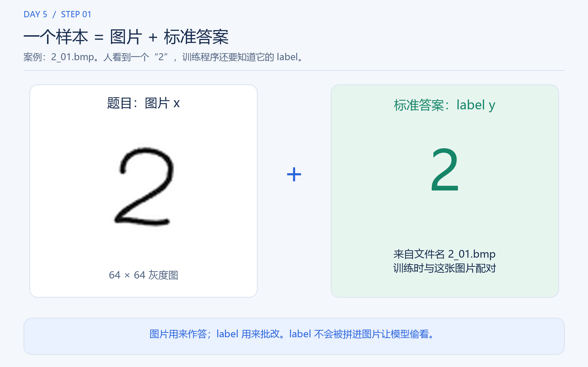
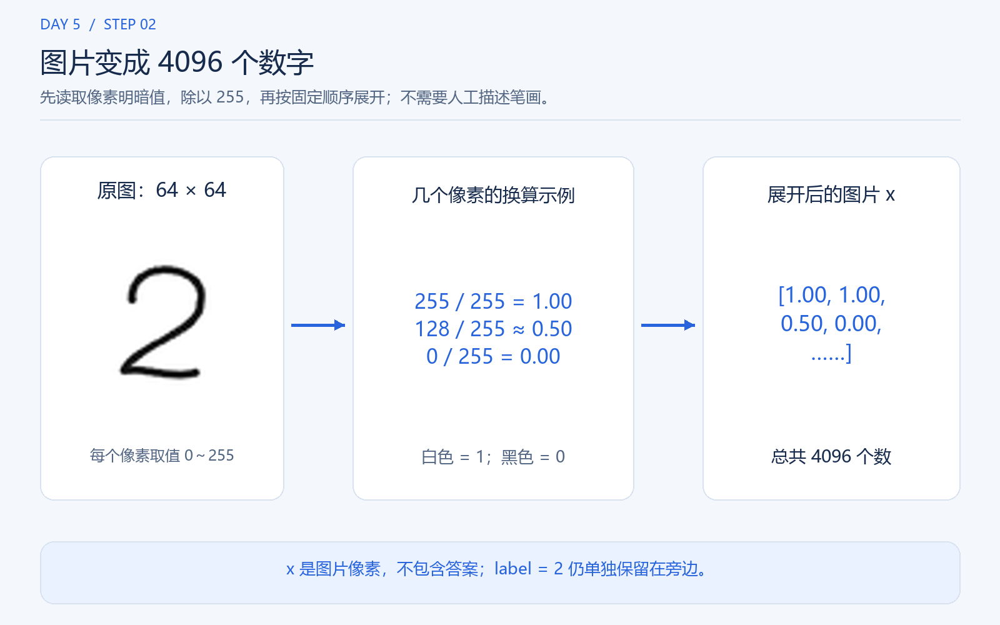
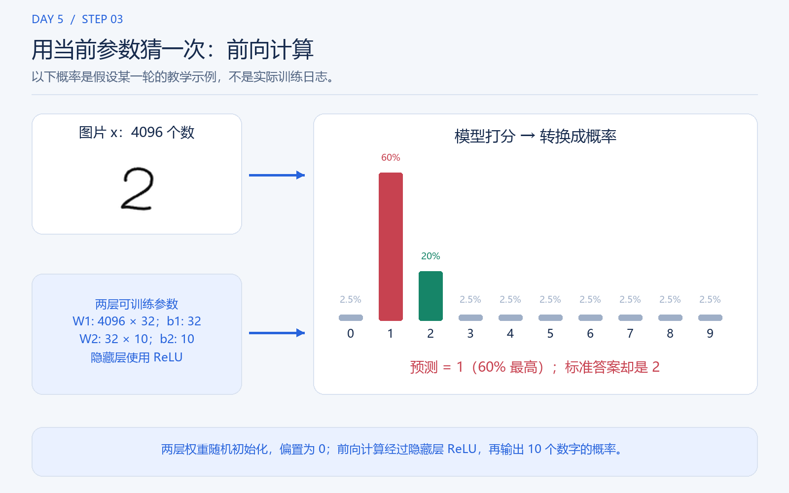
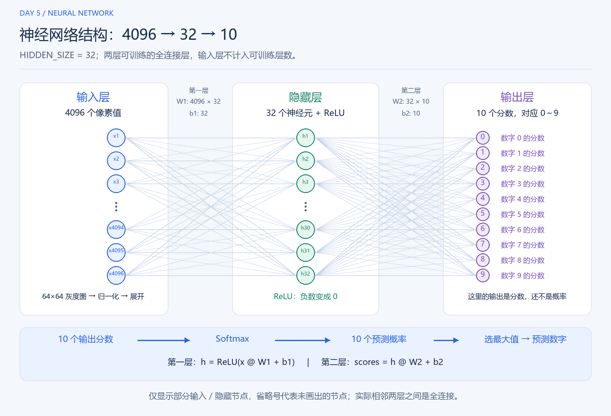
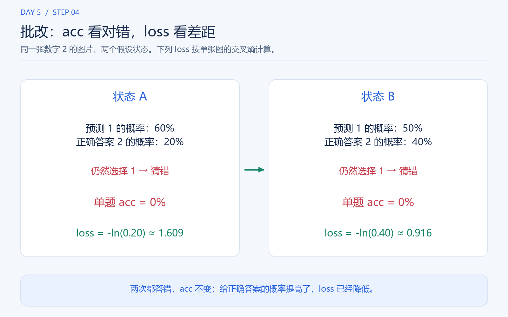
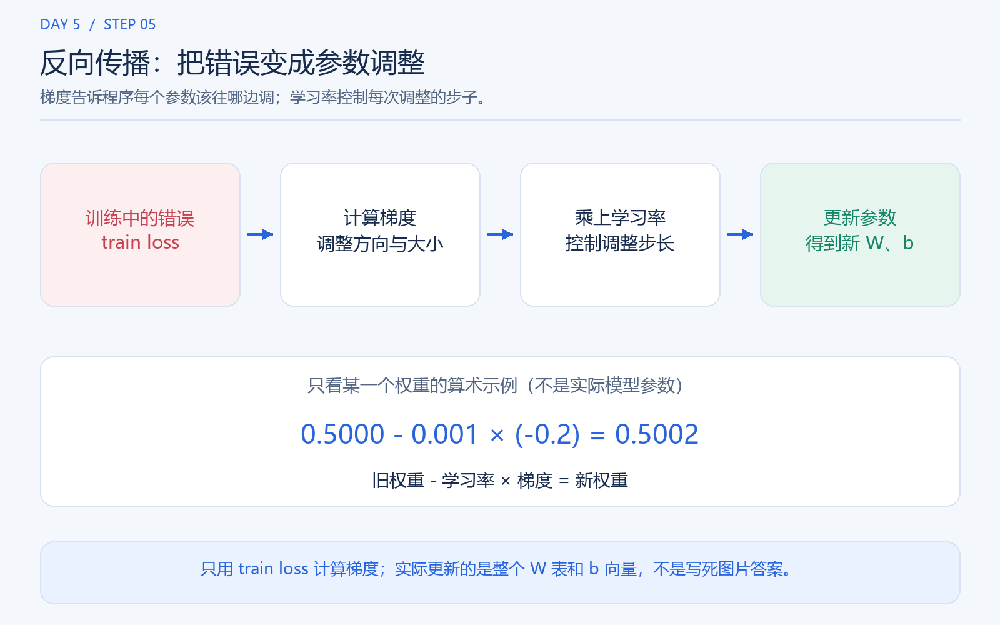
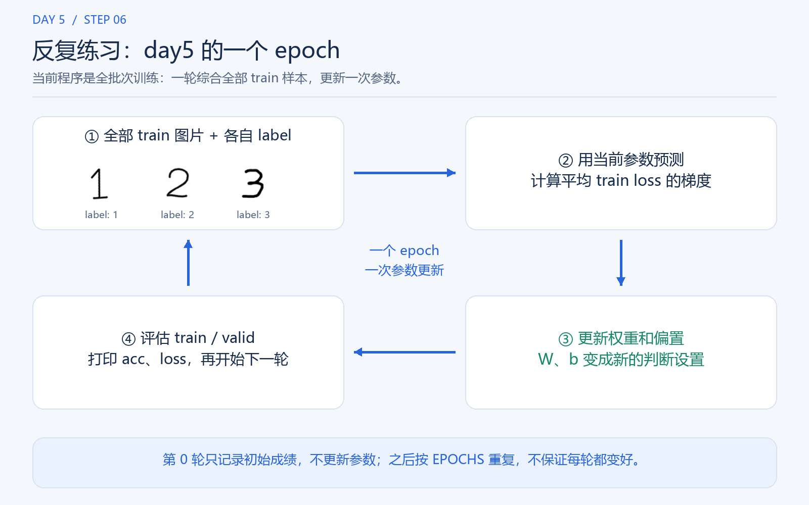
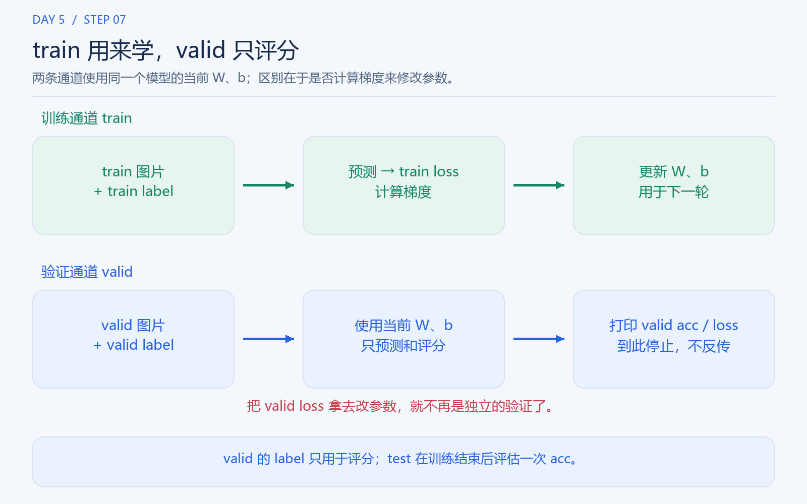
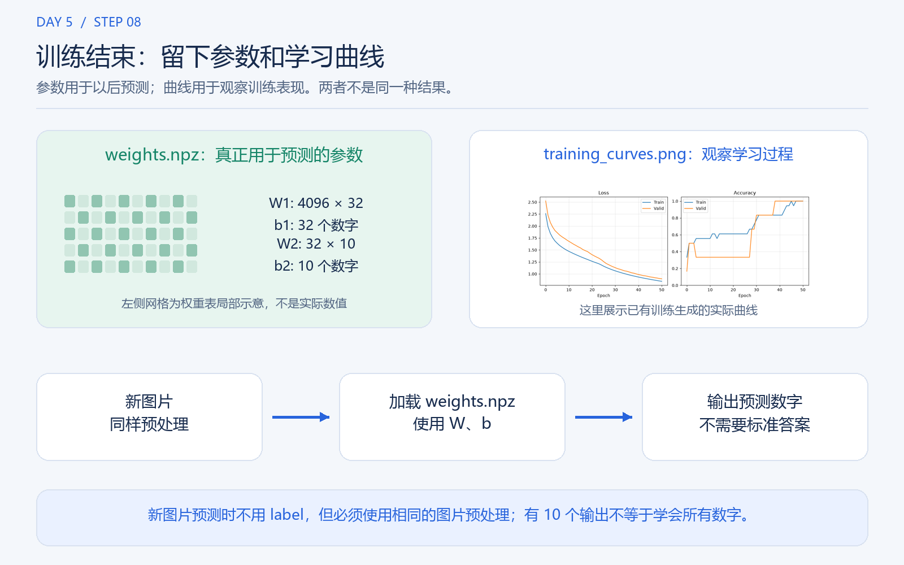

# 一个入门案例：教模型认识手写数字 2

先不看代码，把模型想成一个正在练习认字的学生：

**图片是题目，label 是标准答案，训练是根据错误调整判断方法。**

我们用一张手写数字 **2** 的图片，走一遍整个过程。

## Step 1：准备一道“带答案的题”



假设训练集中有这个文件：

```text
day2\train\2_01.bmp

图片内容：手写数字 2
label：2（标准答案）
```

这个样本由两部分组成：

| 部分 | 是什么 | 有什么用 |
|---|---|---|
| 图片 | 一张 64×64 的灰度图 | 让模型根据它作出预测 |
| label | 数字 2，从文件名中读取 | 检查模型的预测是否正确，指导学习 |

**label 不会作为图片的一部分送进去让模型“偷看答案”。**
模型先根据图片作答，训练程序再拿 label 来批改。

## Step 2：把图片变成模型能处理的数字



人看到的是一个“2”，程序读到的却是 64×64 个像素的明暗值。

day5 会将像素值除以 255，再把这张二维图片展开成一行：

```text
64×64 的图片
    |
    v
4096 个明暗值：[1.0, 1.0, 0.8, 0.0, ...]
```

这里，**0 是黑色，1 是白色，中间的数表示灰色**。
展开只是按固定顺序排列像素，不会自动提取“这是一个弯钩”之类的含义。

此时，我们有了：

```text
x = 图片对应的 4096 个数字
y = 标准答案 2
```

## Step 3：模型先猜一次



当前模型是一个 **4096 → 32 → 10** 的两层神经网络：
输入是 4096 个像素值，中间隐藏层有 32 个神经元，输出对应 0～9 共 10 个数字。
这里的“两层”指两层可训练的全连接层，不把输入层算进去。
隐藏层大小可以通过代码顶部的 `HIDDEN_SIZE` 修改。



这张结构图中的省略号代表未画出的神经元，并不是实际少了这些节点。
修改 `HIDDEN_SIZE` 后，可运行 `python .\study\day5\draw_network.py` 更新结构图。

每个全连接层都有自己的 **权重** 和 **偏置**。
它们共同构成模型当前的“判断设置”。第一层后使用 **ReLU**：
把负数变成 0，保留非负数，让网络不再只是一次线性计算。
配图中的 `W、b` 是网络全部权重和偏置的统称。

模型使用这些设置，对 0～9 分别打分，再将分数转换为总和为 100% 的预测概率：

```text
图片 x：4096 个像素值
          |
          v
第一层：4096 → 32，使用 weights1、bias1
          |
          v
ReLU：负数变成 0
          |
          v
第二层：32 → 10，使用 weights2、bias2
          |
          v
输出 10 个概率，选概率最大的数字作为预测
```

day5 一开始随机初始化两层权重，偏置设为 0。
随机初始化让不同隐藏神经元能够学到不同的内容，初始概率不一定都是 10%；
这些初始设置还没有从训练图片中学到判断方法。

下面为了说明一次学习过程，**假设训练到某一轮时**，模型对这张图给出：

| 预测对象 | 模型给出的概率 |
|---|---:|
| 数字 1 | 60% |
| 数字 2 | 20% |
| 其余数字合计 | 20% |

它会选择 **1**，但标准答案是 **2**，所以这次猜错了。
这些概率只是教学示意，不是实际运行日志，也不代表真实世界中的可靠置信度。

## Step 4：用 label 批改，得到 acc 和 loss



现在训练程序才拿出标准答案：

```text
预测：1
答案：2
结果：错误
```

这里有两个不同的观察角度：

| 指标 | 通俗理解 | 对这个例子意味着什么 |
|---|---|---|
| accuracy，简称 acc | 答对了多少题 | 这张图猜错了，单题正确率为 0% |
| loss | 模型距离理想回答还有多大差距 | 正确答案 2 只得到 20% 概率，仍需要改进 |

day5 使用的 loss 叫作“交叉熵”。先记住一个直觉：
**模型给正确答案的概率越高，这张图的 loss 就越小。**

例如，数字 2 的概率从 20% 变成 40%，但最高概率仍然属于数字 1：
这道题还是答错，acc 不变，可是 loss 已经降低了。
因此，loss 能反映一些“尚未答对，但正在接近答案”的进步。

## Step 5：反向传播，修改判断设置



知道错误还不够，程序还要计算：**每个权重应该往哪个方向调整？**

这个过程就是这里说的反向传播。计算出的调整方向和大小叫作 **梯度**。
day5 直接用 NumPy 写出了这个简单模型的梯度计算，没有调用自动求导工具。

更新规则可以抽象为：

```text
新权重 = 旧权重 - 学习率 × 梯度
```

反向传播先经过输出层，再经过 ReLU 回到隐藏层，计算两层各自的梯度。
两层的权重和偏置都按照同样的规则更新；计算梯度时使用的都是本轮更新前的参数。

学习率控制每次调整的步子有多大。学习率太大，可能越改越不稳定。
训练的目标是让模型整体上更倾向于正确答案，而不是人为写死“这张图就输出 2”。

**真正被保存下来的学习成果，是调整后的权重和偏置。**

## Step 6：从一道题，扩展到整个训练集



上面用一张图来解释。在 day5 的实际代码里，每次更新会一起使用全部 train 图片：

```text
全部 train 图片 + 各自的 label
              |
              v
用当前权重预测，计算平均训练 loss 的梯度
              |
              v
综合所有训练样本，更新一次权重和偏置
              |
              v
用更新后的模型计算并打印 train / valid 的 acc、loss
              |
              v
开始下一轮，重复上述过程
```

这里，一轮叫作一个 **epoch**。因为当前程序每轮使用全部 train 图片计算一次梯度，
所以每个 epoch 更新一次权重。其他训练程序也可能将图片分成多个小批次，
一轮内更新很多次，但 day5 暂时没有这样做。

程序显示的 **Epoch 0** 是更新之前的初始状态。
`EPOCHS` 设置的是之后进行多少轮更新。

训练会综合不同样本的意见，因此不保证每张图都在每轮变好，也不保证每轮 acc 都提高。

## Step 7：用 valid 做“只看成绩、不改答案的测验”



train 和 valid 的分工不同：

| 数据集 | 在当前程序中的作用 | 是否参与权重更新 |
|---|---|---|
| train | 提供练习题和答案，用来学习 | 是 |
| valid，即 day2 的 `val` | 检查当前模型对未参与训练的图片表现如何 | 否 |
| test | 训练结束、保存参数后，使用最终模型评估一次 acc | 否 |

valid 也有 label，否则无法计算 acc 和 loss。
但 **valid 的 label 只用于评分，不用于反向传播**。

如果 train 越来越好，valid 却持续变差，可能说明模型太适应训练图片，
没有学会很好地处理新图片。这是需要警惕的“过拟合”现象。
当前 day5 会按设置的轮数训练完，不会根据 valid 自动提前停止或选择最佳模型。
训练结束后，程序再对 test 集计算一次准确率；test 不参与训练或逐轮评估，也不会修改参数。

## Step 8：训练结束，得到什么？



day5 会留下两类结果：

| 结果 | 保存在哪里 | 用途 |
|---|---|---|
| 最后一轮的权重和偏置 | `day5\weights.npz` | 以后用它们对新图片作出预测 |
| 各轮 train / valid 的 loss、acc 曲线 | `day5\training_curves.png` | 观察模型学习的过程 |

终端也会逐轮打印这些指标，并在保存参数后单独打印一次 `Test accuracy`。
权重文件保存的不是每张题目的答案，也不是“准确率”这个数字，
而是模型计算预测时使用的参数。

`weights.npz` 现在保存两层的四组参数，不再是旧版的一组 `weights`、`bias`：

| 文件中的参数名 | 默认形状 | 用途 |
|---|---|---|
| `weights1` | 4096×32 | 将像素映射到隐藏层 |
| `bias1` | 32 | 隐藏层偏置 |
| `weights2` | 32×10 | 将隐藏层映射到数字分数 |
| `bias2` | 10 | 输出层偏置 |

4096 对应图片像素数，32 是可修改的隐藏层大小，10 对应数字 0～9 的输出位置。
有 10 个输出位置，并不表示模型已经学会了所有数字；仍然需要相应的训练样本。

以后识别新图片时：

```text
新图片 -> 同样的像素处理 -> 使用训练好的权重和偏置 -> 预测数字
```

**这时不需要提供 label。** 如果之后想判断预测对不对，才需要标准答案来评分。
另外，day5 的 `.npz` 参数文件与 day3 的 `.joblib` 模型格式不同，
目前不能直接放进 day4 的 app 加载。

---

一句话总结：

**训练不是把答案塞进图片，而是反复“看图作答 → 对照答案 → 调整参数”，
最后得到一套能够用于新图片的判断参数。**

## 如何重新生成配图

配图脚本只需要 Pillow，默认使用 Windows 的微软雅黑字体：

```powershell
python .\study\day5\make_training_diagrams.py
```

脚本读取 day1 的 `2_01.bmp`、day2 的训练图片和 day5 已生成的
`training_curves.png`，生成本文的 8 张 PNG 配图。Step 8 中的曲线缩略图来自
这个已有文件；其他标为“示意”或“示例”的数字不代表实际训练日志。
重新训练后，可再次运行脚本来更新 Step 8 的曲线缩略图。
如果系统没有默认字体，可通过 `--font` 指定一个支持中文的字体文件。
